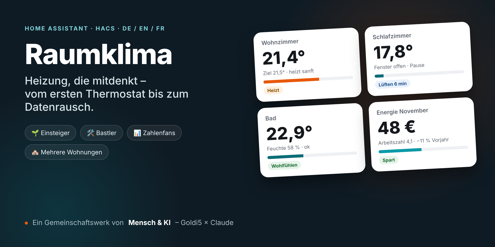
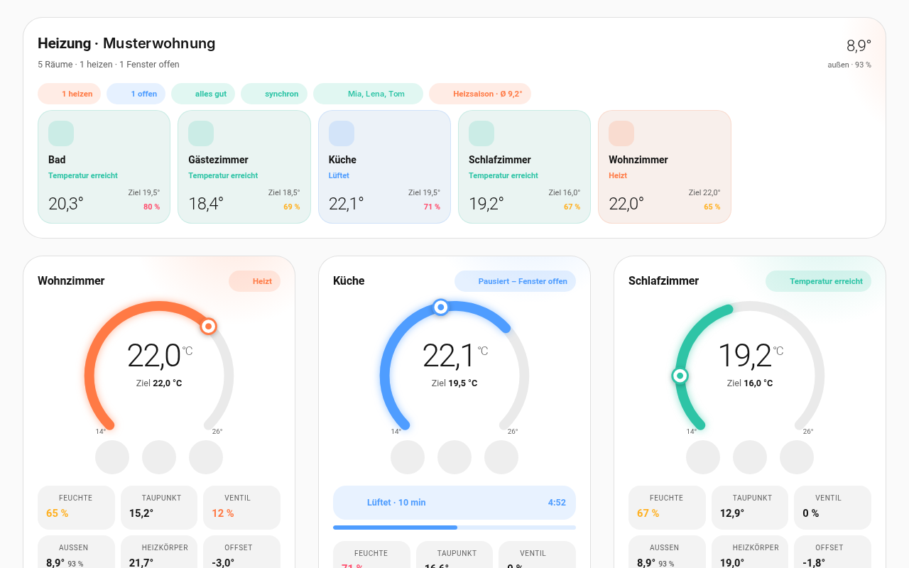
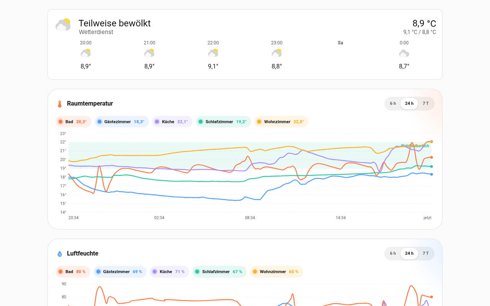
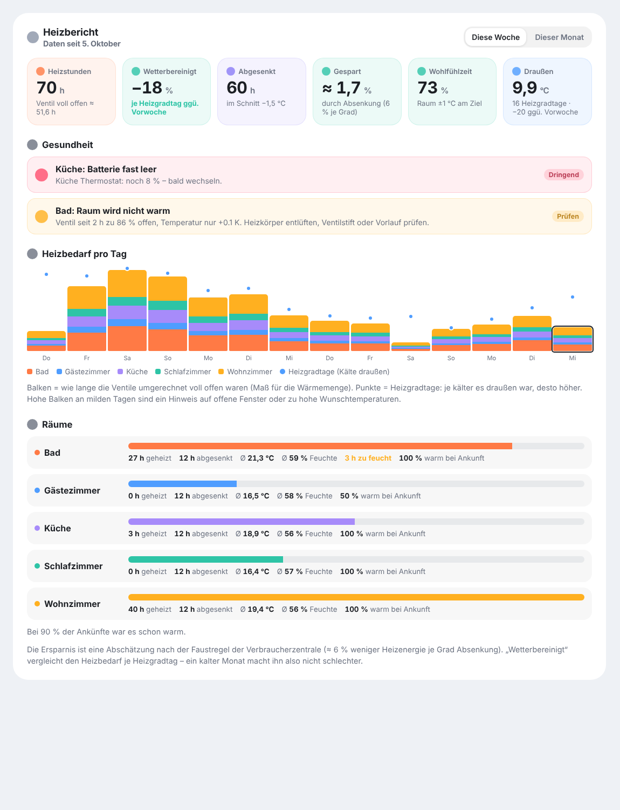
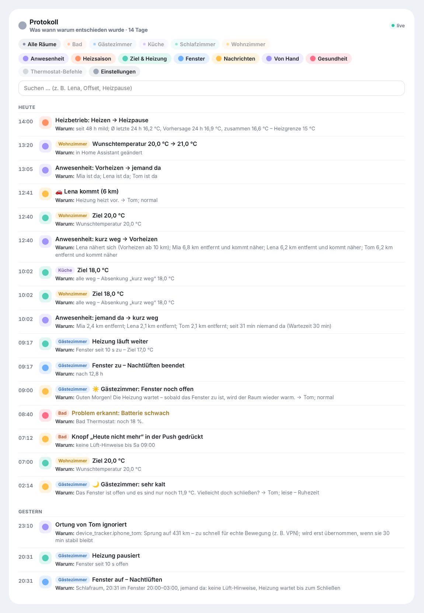
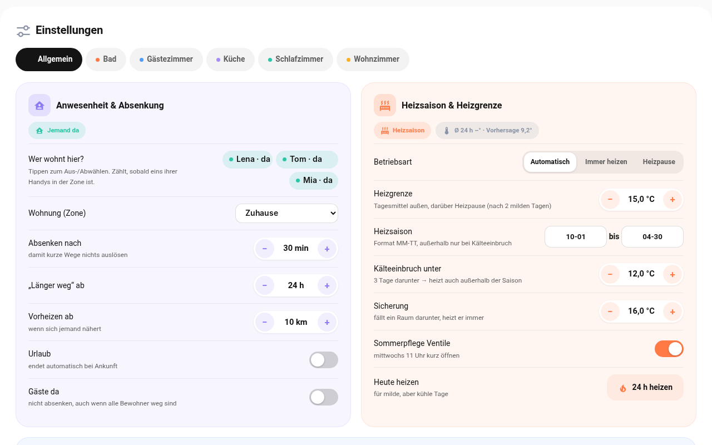

# Raumklima für Home Assistant

**Heizung, die mitdenkt.** Raumklima macht aus jedem Heizkörperthermostat (TRV) ein intelligentes Raumthermostat: Es regelt nach einem echten Raumfühler, pausiert bei offenem Fenster, berät beim Lüften, senkt ab, wenn niemand zu Hause ist – mit Schimmelschutz – und heizt nur, wenn es draußen wirklich kalt ist.

**Aktuelle Version: 1.3.0b9** – Änderungen siehe [CHANGELOG.md](CHANGELOG.md) · Geplant: [ROADMAP.md](ROADMAP.md) · 🇬🇧 [English documentation](docs/en/README.md) · 🇫🇷 [Documentation en français](docs/fr/README.md)

> 📘 **Handbuch als PDF** – Einrichtung Schritt für Schritt, alle Funktionen, häufige Fragen: [Deutsch](https://github.com/Goldi5/Raumklima-2/releases/latest/download/Raumklima-Handbuch.pdf) · [English](https://github.com/Goldi5/Raumklima-2/releases/latest/download/Raumklima-Manual.pdf) · [Français](https://github.com/Goldi5/Raumklima-2/releases/latest/download/Raumklima-Manuel.pdf)

## Für wen ist das?

Ganz ehrlich: für ziemlich viele – aber nicht für alle. Schau, wo du dich wiederfindest.

| | |
|---|---|
| 🌱 **Du fängst gerade an** | Ein paar Thermostate, Home Assistant läuft irgendwie, und du willst vor allem eins: dass es warm ist, wenn du heimkommst, und eine Übersicht, die man auch ohne Informatikstudium versteht. Thermostat wählen, Fühler bestätigen, fertig – das Dashboard baut sich selbst. Alles andere darf warten. |
| 🛠️ **Du bastelst gern** | Du hast mehr Sensoren als Steckdosen, liest Changelogs zum Frühstück und probierst Betas aus, „nur mal kurz“. Für dich gibt es Präsenzmelder, CO₂, Kalender, eigene Automationen, Diagnose-Dateien und einen Reiter „Warum heizt der Raum (nicht)?“ mit jeder einzelnen Regel. Viel Spaß beim Ausprobieren – und bitte erzähl uns, was kaputtgegangen ist. |
| 📊 **Du liebst Zahlen** | Wetterbereinigter Vergleich, Note A–F, Schimmel-Ampel, Heizkosten in Euro, Öltank und Arbeitszahl der Wärmepumpe, PDF-Bericht per Mail. Für alle, die beim Wort „Gradtage“ ein kleines bisschen glücklich werden. |
| 🏘️ **Du kümmerst dich um mehr als eine Wohnung** | Zuhause, Ferienwohnung, die Wohnung der Tochter in einer anderen Stadt – jede mit eigenen Bewohnern, Benachrichtigungen und Berichten, alles in einer Home-Assistant-Installation. |
| 🤷 **Eher nichts für dich, wenn …** | … du eine zertifizierte Profi-Lösung mit Hotline suchst oder deine Heizung lieber gar nicht von Software anfassen lässt. Völlig in Ordnung – ein gutes Thermostat mit Zeitplan ist auch schon was. |

## Mensch + KI: wie das hier entsteht

Raumklima ist ein **Gemeinschaftswerk**: Die Ideen, der Alltagstest in echten Wohnungen (inklusive kalter Füße, wenn mal was schiefging) und die Entscheidungen kommen vom Menschen hinter [Goldi5](https://github.com/Goldi5). Ein großer Teil des Codes, der Tests und der Dokumentation ist zusammen mit der KI **Claude** von Anthropic entstanden – im Gespräch, Zeile für Zeile, mit vielen Rückfragen in beide Richtungen.

Das sagen wir offen, weil es dazugehört. Jede Version läuft durch automatische Tests und wird in echten Wohnungen ausprobiert, bevor sie als stabil gilt. Trotzdem gilt: Es ist ein Hobbyprojekt, kein Produkt mit Garantie.

**Fragen, Issues und Antworten – auch mit KI.** Wer ein Issue aufmacht oder eine Frage stellt, bekommt die Antwort oft mit Hilfe von Claude oder einer anderen KI geschrieben. Nicht aus Bequemlichkeit, sondern weil die KI den ganzen Code im Kopf hat und schneller und tiefer in der Materie steckt als ich. Ich lese mit, entscheide und stehe dafür gerade – versprochen. Und wenn die Antwort mal zu gründlich ausfällt: Das ist dann wohl die KI. 😉

**Du entscheidest.** Ob du Raumklima nutzt, nur reinschaust, Teile davon übernimmst oder es lieber lässt – alles völlig freiwillig und völlig in Ordnung. Wenn du mitmachst: Fehlermeldungen und Wünsche sind herzlich willkommen, egal ob von Mensch oder mit Hilfe einer KI geschrieben. 😉

## Funktionen

| | |
|---|---|
| 🌡️ **Regeln nach dem Raumfühler** | automatischer Offset oder Sollwert-Ausgleich, Notbetrieb bei Fühlerausfall |
| 🔥 **Mehrere Heizkörper pro Raum** | weitere Thermostate laufen mit – jedes mit eigener Prüfung und eigenem Korrekturwert; beliebig viele Fensterkontakte |
| 🪟 **Fensterlogik** | nach 10 s offen Pause, nach 10 s zu weiter – Einstellung bleibt erhalten; offenes Fenster auch **ohne Kontakt** am Temperatursturz erkennen |
| 🌙 **Nachtlüften** | bei offenem Fenster schlafen: keine Lüft-Hinweise, leise Kältewarnung, Morgengruß zum Ende der Ruhezeit |
| 🛡️ **Absicherung** | jeder Befehl wird geprüft und wiederholt – gegen Funk- und VPN-Aussetzer |
| 💨 **Lüftungsassistent** | Feuchtegrenze je Raum, optional **CO₂-Sensor** (ab 1000 ppm) und **Feinstaub PM2,5** (ab 35 µg/m³), Lüftdauer nach Außentemperatur, „trocknet Lüften überhaupt?“, Warnung beim Auskühlen; optionaler **Entfeuchter** schaltet sich selbst |
| 🏠 **Abwesenheit** | Bewohner + Wohnungs-Zone, Absenkung „kurz weg“ / „länger weg“, Urlaub & Gäste, robuste Ortung (mehrere Handys, VPN-Sprungfilter) |
| 🗓️ **Zeitpläne** | eigene Zeitfenster je Raum oder ein HA-**Zeitplan-Helfer**; Räume für bestimmte Personen oder einen Gast-Schalter; auf Wunsch **Hysterese-Regelung** (Ventil ganz auf/zu) |
| 📅 **Kalender** | Termine wie „Urlaub“ senken ab wie der Urlaubsschalter, „Homeoffice“ verhindert das Absenken – Wörter einstellbar; ein Schulferien-Kalender verschiebt Morgen-Zeitfenster |
| 🚗 **Vorheizen nach Ankunftszeit** | lernt die Aufheizzeit jedes Raums und heizt so früh vor, dass es bei der Ankunft warm ist |
| 😴 **Schlafenszeiten lernen** | aus Nachtlüften und Licht – Ruhezeit passt sich an, Wochenende und Feiertage (je Bundesland) getrennt |
| 🧱 **Schimmelschutz** | Absenkung nach DIN 4108-2 – die kälteste Wandstelle bleibt unter 80 % Feuchte |
| 🍂 **Heizsaison** | Heizgrenze nach Tagesmittel aus Messung + Wettervorhersage, Kälteeinbruch-Regel, „Heute heizen“, Sommerpflege der Ventile |
| ☀️ **Wettervorhersage** | Sonnenseite-Räume heizen bei erwarteter Sonne 1 °C weniger; in Frostnächten (≤ −5 °C) nur halb so tief absenken |
| 📱 **Benachrichtigungen** | pro Empfänger wählbar, welche Nachrichten; Push mit Knöpfen, Ruhezeit (am Wochenende länger), optional Sprachansagen; **Lüft-Countdown auf dem Sperrbildschirm** (Live-Aktivität) |
| 👤 **Präsenzmelder** | mmWave und PIR (PIR vorsichtiger gewichtet): niemand fälschlich „weg“, solange jemand da ist; leere Räume auf Wunsch etwas kühler; **Anwesenheits-Temperatur** je Raum (z. B. 21 °C, solange jemand da ist), Lampen zählen als Anwesenheit, **Vorwärmen nach gelernten Belegungszeiten** |
| 💡 **Lichtsignal** | Lampen im Raum blinken blau bei „Bitte lüften“, orange bei „Bitte schließen“ – danach wie vorher |
| 📈 **Heizbericht** | Woche/Monat: Heizstunden, wetterbereinigter Vergleich, Ersparnis durch Absenkung, Wohlfühlzeit; Wochen-Push sonntags; **CSV-Export**; **PDF-Bericht** für Woche, Monat und Heizsaison mit Note A–F, Vorjahresvergleich, Feuchte-Ampel, Wärmebild, Rangliste und Spartipps (auf Wunsch in Euro) – per Push-Link, E-Mail oder Download. **Heizöl** mit Literpreis, Tankfüllstand, Bestellhinweis, Winterverbrauch, Preisverlauf und Marktpreisvergleich |
| ⚡ **Energie & Kosten** | Wärmepumpe, Gas, Öl, Fernwärme oder Strom: Kosten mit Hochrechnung, **gemessene Arbeitszahl**, **Warmwasser** extra, Anteil am **Hausstrom**, PV und Batterie Stunde für Stunde abgezogen; **dynamische Tarife** (z. B. 1KOMMA5°, Tibber, EPEX Spot) mit Reserve-Preisquellen, Preiskurve und Kosten je Raum – Raumklima rechnet nur aus und steuert die Heizung nicht |
| 🧾 **Protokoll** | live: was wann warum entschieden wurde – Anwesenheit, Ziele, Fenster, Nachrichten, Thermostat-Befehle |
| 🩺 **Gesundheitscheck** | Batterien, „Raum wird nicht warm“, „Heizkörper kommt kaum hinterher“ (hydraulischer Abgleich), Fühler hängt oder fehlt, Funk- und Verbindungsaussetzer, stiller Fensterkontakt, Schutz gegen Endlosschleifen mit dem Thermostat; **Batterie-Prognose** („hält noch ~40 Tage“) und Warnung bei auffällig vielen Funkbefehlen |
| 👁️ **Überwachungsraum** | Raum ohne Thermostat: Temperatur, Feuchte, CO₂ und Feinstaub messen, Lüftung anmahnen, berichten – mit eigener großer Karte im Dashboard, ohne jede Heizungsbedienung |
| 🧠 **Lernen & Warum** | zeigt je Raum die gelernte Aufheizrate, daraus die Vorheizzeit und wie belastbar die Werte sind; auf Wohnungsebene Schlafzeiten und ein **Anwesenheitsprofil** (nur „jemand da“, nie wer); dazu ein Reiter **Entscheidungen** mit Filter nach Zeitraum und Bereich – jede Zeile mit Begründung und Messwerten; Prüfseite **„Warum heizt der Raum (nicht)?“** mit allen Voraussetzungen und jeder Regel |
| 🏘️ **Mehrere Wohnungen** | z. B. Zuhause und Ferienwohnung – je eigene Bewohner, Empfänger, Bericht und Protokoll, Umschalter im Dashboard |
| 📊 **Dashboard** | Raumkarten, Verlauf mit Zeitleiste, Bericht, Protokoll, komplett bearbeitbare Einstellungsseite (Gruppenleiste, Suche, Reihenfolge/Größe/Farbe, Kalender- und Zeitwähler) – automatisch per Strategie, **Deutsch, Englisch oder Französisch** – auch Push-Nachrichten und Protokoll |
| ⚙️ **Eigene Automationen** | Geräte-Auslöser „Bitte lüften“, „Fenster geöffnet“, „Heizung pausiert“, „Gesundheit“ … |

 
 

## Installation

1. **Marketplace** (früher HACS) → ⋮ → **Benutzerdefinierte Repositories** → `https://github.com/Goldi5/Raumklima-2` (Integration)
2. **Raumklima** herunterladen, Home Assistant neu starten
3. **Einstellungen → Geräte & Dienste → Integration hinzufügen → Raumklima**: Thermostat wählen, Fühler bestätigen, Raumtyp wählen – fertig. Beim ersten Raum zusätzlich Bewohner, Wohnung und Benachrichtigungen.
4. Dashboard hinzufügen → **Raumklima** (Strategie)

Ausführlich: [Installation & Einrichtung](docs/de/installation.md)

## Dokumentation

| | Deutsch | English | Français |
|---|---|---|---|
| 📘 Handbuch (PDF, für Einsteiger) | [Raumklima-Handbuch.pdf](https://github.com/Goldi5/Raumklima-2/releases/latest/download/Raumklima-Handbuch.pdf) | [Raumklima-Manual.pdf](https://github.com/Goldi5/Raumklima-2/releases/latest/download/Raumklima-Manual.pdf) | [Raumklima-Manuel.pdf](https://github.com/Goldi5/Raumklima-2/releases/latest/download/Raumklima-Manuel.pdf) |
| Übersicht | [README](docs/de/README.md) | [README](docs/en/README.md) | [README](docs/fr/README.md) |
| Installation & Einrichtung | [installation](docs/de/installation.md) | [installation](docs/en/installation.md) | [installation](docs/fr/installation.md) |
| Bedienung | [bedienung](docs/de/bedienung.md) | [usage](docs/en/usage.md) | [utilisation](docs/fr/utilisation.md) |
| So funktioniert's | [funktionsweise](docs/de/funktionsweise.md) | [how it works](docs/en/how-it-works.md) | [fonctionnement](docs/fr/fonctionnement.md) |
| Benachrichtigungen | [benachrichtigungen](docs/de/benachrichtigungen.md) | [notifications](docs/en/notifications.md) | [notifications](docs/fr/notifications.md) |
| Referenz | [referenz](docs/de/referenz.md) | [reference](docs/en/reference.md) | [reference](docs/fr/reference.md) |
| Häufige Fragen | [faq](docs/de/faq.md) | [faq](docs/en/faq.md) | [faq](docs/fr/faq.md) |
| Fehlerbehebung | [fehlerbehebung](docs/de/fehlerbehebung.md) | [troubleshooting](docs/en/troubleshooting.md) | [dépannage](docs/fr/depannage.md) |
| Entwickeln | [entwickeln](docs/de/entwickeln.md) | [development](docs/en/development.md) | [développement](docs/fr/developpement.md) |

## Kompatibilität

- Home Assistant 2026.5+ (Strategie), Integration ab 2025.10
- Jedes `climate`-Thermostat; getestet mit Tuya **TRV602Z** über Zigbee2MQTT und IKEA-Fühlern; Hinweise je Gerätetyp (Shelly, Matter/Thread, Cloud …): [Welche Thermostate funktionieren?](docs/de/installation.md#welche-thermostate-funktionieren)
- Benachrichtigungen über jeden `notify`-Dienst (Companion App, Alexa Media, …)

## Lizenz & Mitmachen

Open Source, entstanden als Gemeinschaftswerk von Mensch und KI (Claude). Nutzung auf eigene Verantwortung – und mit Freude. Fehler und Wünsche gerne als [Issue](https://github.com/Goldi5/Raumklima-2/issues) – mit Diagnose-Datei (Gerät → ⋮ → Diagnose herunterladen).
