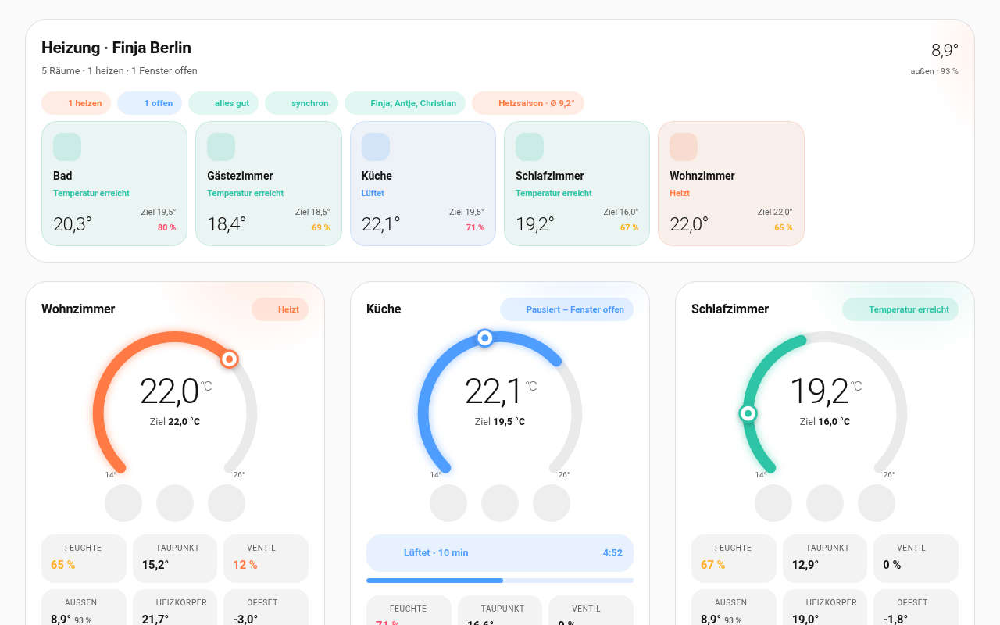
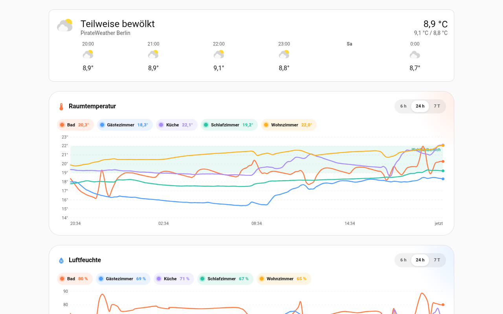
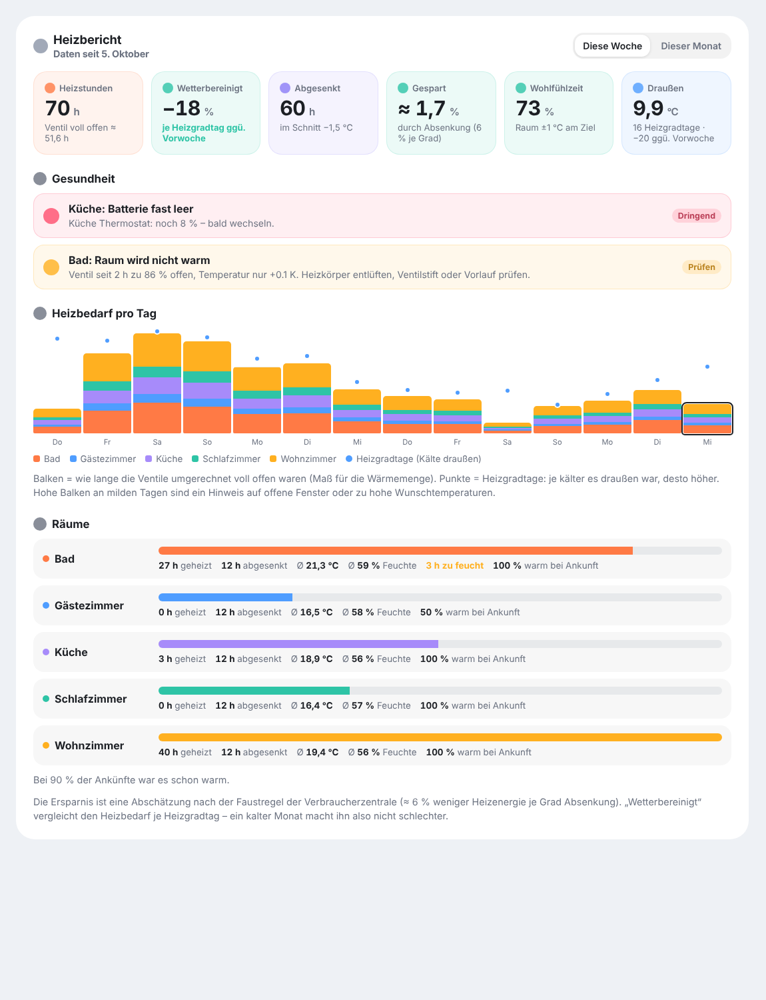
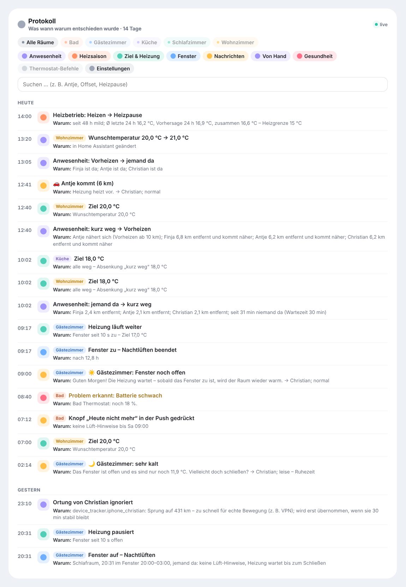
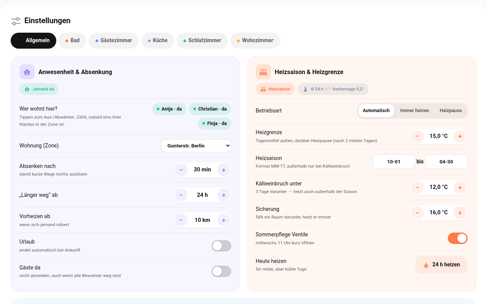

# Raumklima für Home Assistant

**Heizung, die mitdenkt.** Raumklima macht aus jedem Heizkörperthermostat (TRV) ein intelligentes Raumthermostat: Es regelt nach einem echten Raumfühler, pausiert bei offenem Fenster, berät beim Lüften, senkt ab, wenn niemand zu Hause ist – mit Schimmelschutz – und heizt nur, wenn es draußen wirklich kalt ist.

**Aktuelle Version: 0.14.4** – Änderungen siehe [CHANGELOG.md](CHANGELOG.md) · 🇬🇧 [English documentation](docs/en/README.md)

> 📘 **Handbuch als PDF** – Einrichtung Schritt für Schritt, alle Funktionen, häufige Fragen: [Deutsch](https://github.com/Goldi5/Raumklima-2/releases/latest/download/Raumklima-Handbuch.pdf) · [English](https://github.com/Goldi5/Raumklima-2/releases/latest/download/Raumklima-Manual.pdf)

## Funktionen

| | |
|---|---|
| 🌡️ **Regeln nach dem Raumfühler** | automatischer Offset oder Sollwert-Ausgleich, Notbetrieb bei Fühlerausfall |
| 🪟 **Fensterlogik** | nach 10 s offen Pause, nach 10 s zu weiter – Einstellung bleibt erhalten; offenes Fenster auch **ohne Kontakt** am Temperatursturz erkennen |
| 🌙 **Nachtlüften** | bei offenem Fenster schlafen: keine Lüft-Hinweise, leise Kältewarnung, Morgengruß zum Ende der Ruhezeit |
| 🛡️ **Absicherung** | jeder Befehl wird geprüft und wiederholt – gegen Funk- und VPN-Aussetzer |
| 💨 **Lüftungsassistent** | Feuchtegrenze je Raum, optional **CO₂-Sensor** (ab 1000 ppm), Lüftdauer nach Außentemperatur, „trocknet Lüften überhaupt?“, Warnung beim Auskühlen |
| 🏠 **Abwesenheit** | Bewohner + Wohnungs-Zone, Absenkung „kurz weg“ / „länger weg“, Urlaub & Gäste, robuste Ortung (mehrere Handys, VPN-Sprungfilter) |
| 📅 **Kalender** | Termine wie „Urlaub“ senken ab wie der Urlaubsschalter, „Homeoffice“ verhindert das Absenken – Wörter einstellbar |
| 🚗 **Vorheizen nach Ankunftszeit** | lernt die Aufheizzeit jedes Raums und heizt so früh vor, dass es bei der Ankunft warm ist |
| 😴 **Schlafenszeiten lernen** | aus Nachtlüften und Licht – Ruhezeit passt sich an, Wochenende und Feiertage (je Bundesland) getrennt |
| 🧱 **Schimmelschutz** | Absenkung nach DIN 4108-2 – die kälteste Wandstelle bleibt unter 80 % Feuchte |
| 🍂 **Heizsaison** | Heizgrenze nach Tagesmittel aus Messung + Wettervorhersage, Kälteeinbruch-Regel, „Heute heizen“, Sommerpflege der Ventile |
| ☀️ **Wettervorhersage** | Sonnenseite-Räume heizen bei erwarteter Sonne 1 °C weniger; in Frostnächten (≤ −5 °C) nur halb so tief absenken |
| 📱 **Benachrichtigungen** | pro Empfänger wählbar, welche Nachrichten; Push mit Knöpfen, Ruhezeit (am Wochenende länger), optional Sprachansagen; **Lüft-Countdown auf dem Sperrbildschirm** (Live-Aktivität) |
| 👤 **Präsenzmelder** | mmWave und PIR (PIR vorsichtiger gewichtet): niemand fälschlich „weg“, solange jemand da ist; leere Räume auf Wunsch etwas kühler |
| 💡 **Lichtsignal** | Lampen im Raum blinken blau bei „Bitte lüften“, orange bei „Bitte schließen“ – danach wie vorher |
| 📈 **Heizbericht** | Woche/Monat: Heizstunden, wetterbereinigter Vergleich, Ersparnis durch Absenkung, Wohlfühlzeit; Wochen-Push sonntags; **CSV-Export**; **PDF-Bericht** für Woche, Monat und Heizsaison mit Note A–F, Vorjahresvergleich, Feuchte-Ampel, Wärmebild, Rangliste und Spartipps (auf Wunsch in Euro) – per Push-Link, E-Mail oder Download |
| 🧾 **Protokoll** | live: was wann warum entschieden wurde – Anwesenheit, Ziele, Fenster, Nachrichten, Thermostat-Befehle |
| 🩺 **Gesundheitscheck** | Batterien, „Raum wird nicht warm“, „Heizkörper kommt kaum hinterher“ (hydraulischer Abgleich), Fühler hängt oder fehlt, Funk- und Verbindungsaussetzer, stiller Fensterkontakt, Schutz gegen Endlosschleifen mit dem Thermostat |
| 🏘️ **Mehrere Wohnungen** | z. B. Berlin und Remscheid – je eigene Bewohner, Empfänger, Bericht und Protokoll, Umschalter im Dashboard |
| 📊 **Dashboard** | Raumkarten, Verlauf mit Zeitleiste, Bericht, Protokoll, komplett bearbeitbare Einstellungsseite – automatisch per Strategie, **Deutsch oder Englisch** |
| ⚙️ **Eigene Automationen** | Geräte-Auslöser „Bitte lüften“, „Fenster geöffnet“, „Heizung pausiert“, „Gesundheit“ … |

 
 

## Installation

1. HACS → ⋮ → **Benutzerdefinierte Repositories** → `https://github.com/Goldi5/Raumklima-2` (Integration)
2. **Raumklima** herunterladen, Home Assistant neu starten
3. **Einstellungen → Geräte & Dienste → Integration hinzufügen → Raumklima**: Thermostat wählen, Fühler bestätigen, Raumtyp wählen – fertig. Beim ersten Raum zusätzlich Bewohner, Wohnung und Benachrichtigungen.
4. Dashboard hinzufügen → **Raumklima** (Strategie)

Ausführlich: [Installation & Einrichtung](docs/de/installation.md)

## Dokumentation

| | Deutsch | English |
|---|---|---|
| 📘 Handbuch (PDF, für Einsteiger) | [Raumklima-Handbuch.pdf](https://github.com/Goldi5/Raumklima-2/releases/latest/download/Raumklima-Handbuch.pdf) | [Raumklima-Manual.pdf](https://github.com/Goldi5/Raumklima-2/releases/latest/download/Raumklima-Manual.pdf) |
| Übersicht | [README](docs/de/README.md) | [README](docs/en/README.md) |
| Installation & Einrichtung | [installation](docs/de/installation.md) | [installation](docs/en/installation.md) |
| Bedienung | [bedienung](docs/de/bedienung.md) | [usage](docs/en/usage.md) |
| So funktioniert's | [funktionsweise](docs/de/funktionsweise.md) | [how it works](docs/en/how-it-works.md) |
| Benachrichtigungen | [benachrichtigungen](docs/de/benachrichtigungen.md) | [notifications](docs/en/notifications.md) |
| Referenz | [referenz](docs/de/referenz.md) | [reference](docs/en/reference.md) |
| Häufige Fragen | [faq](docs/de/faq.md) | [faq](docs/en/faq.md) |
| Fehlerbehebung | [fehlerbehebung](docs/de/fehlerbehebung.md) | [troubleshooting](docs/en/troubleshooting.md) |
| Entwickeln | [entwickeln](docs/de/entwickeln.md) | [development](docs/en/development.md) |

## Kompatibilität

- Home Assistant 2026.5+ (Strategie), Integration ab 2025.10
- Jedes `climate`-Thermostat; getestet mit Tuya **TRV602Z** über Zigbee2MQTT und IKEA-Fühlern; Hinweise zu [Matter/Thread](docs/de/installation.md#matter--thread-thermostate)
- Benachrichtigungen über jeden `notify`-Dienst (Companion App, Alexa Media, …)

## Lizenz & Mitmachen

Open Source. Fehler und Wünsche gerne als [Issue](https://github.com/Goldi5/Raumklima-2/issues) – mit Diagnose-Datei (Gerät → ⋮ → Diagnose herunterladen).
