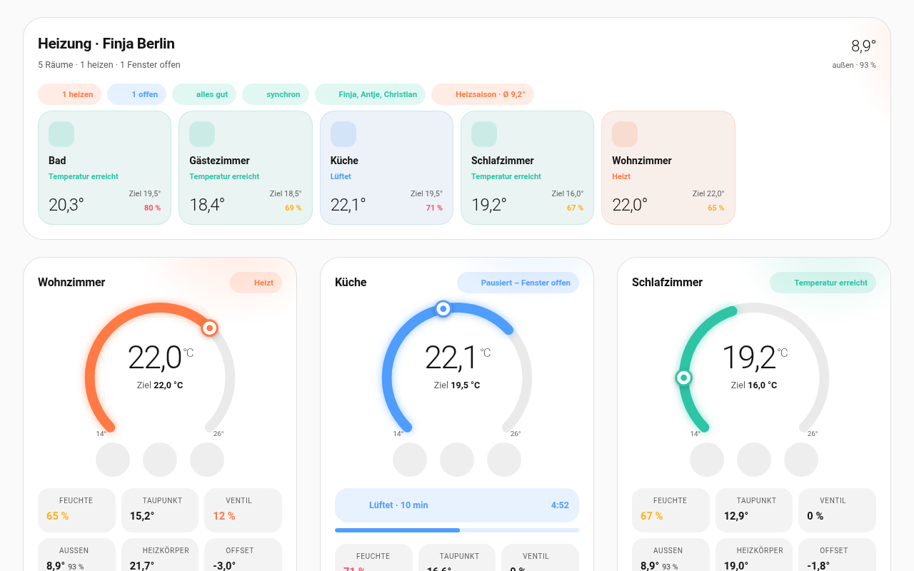
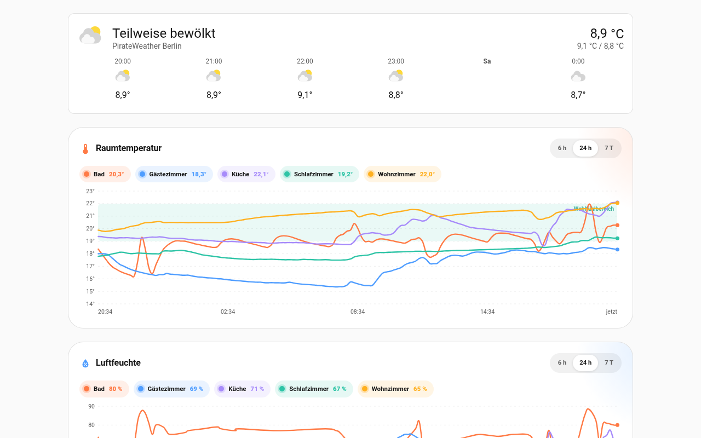
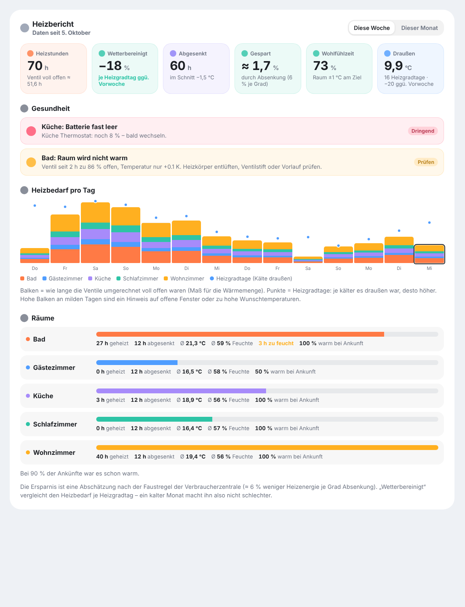
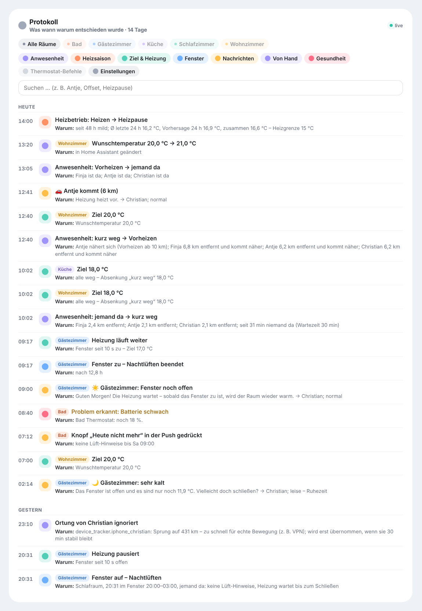
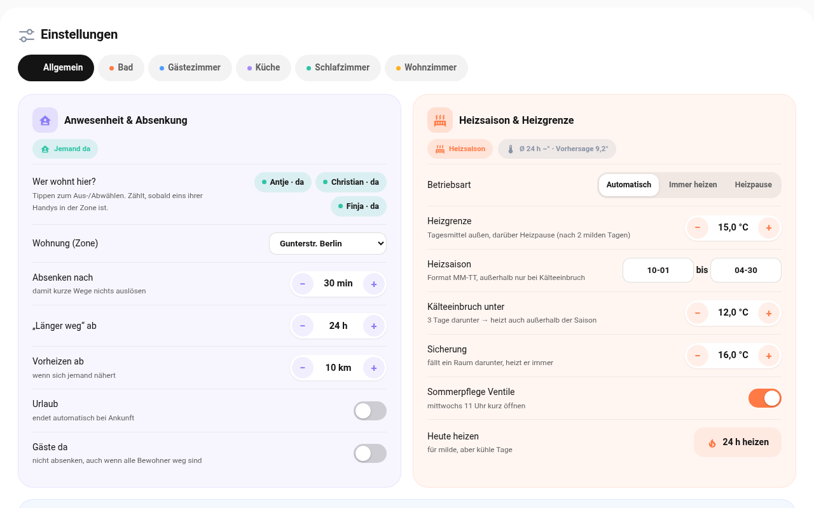
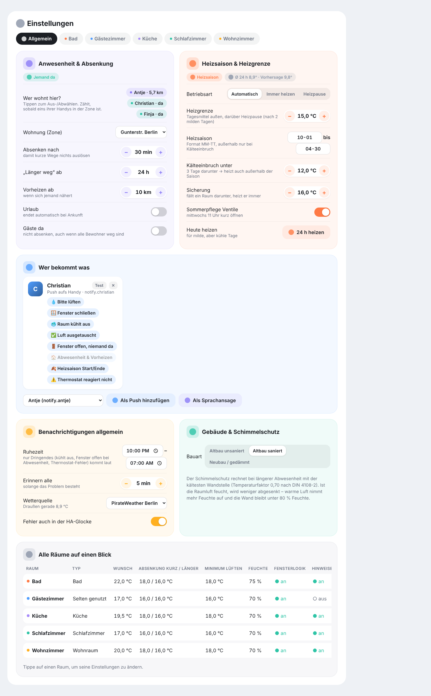
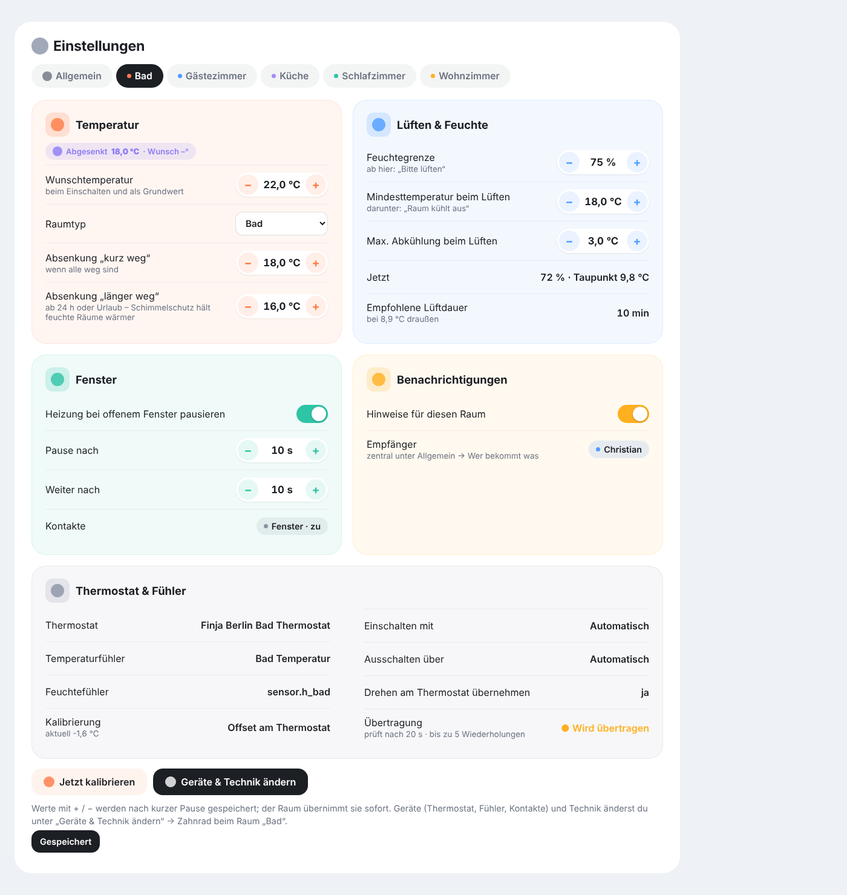
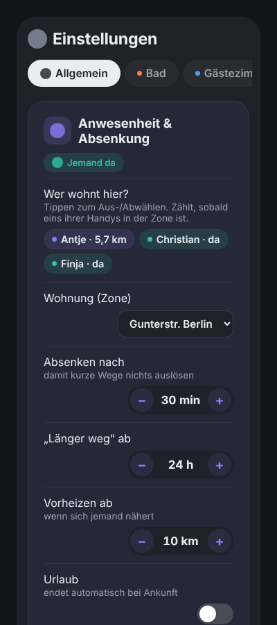

# Bedienung

## Reiter „Räume“



**Übersicht oben:** alle Räume als Kacheln mit Ist-Temperatur, Ziel, Luftfeuchte und Status. Die Chips zeigen, wie viele Räume heizen, offene Fenster, Hinweise, den Übertragungsstatus – und neu, wer zu Hause ist und ob gerade Heizsaison oder Heizpause ist.

**Raumkarte:**
- Der **Bogen** zeigt die Ist-Temperatur, der **Knopf** das Ziel. Mit **−/+** in 0,5-°C-Schritten, mit **⏻** an/aus.
- Unter der Temperatur steht, was gerade gilt: *Ziel 20 °C*, *Abgesenkt 18 °C · Wunsch 20°*, *Heizpause* oder *Frostschutz*.
- Mit Präsenzmelder steht unter dem Namen **„Jemand im Raum“** oder **„Raum leer seit 25 min“** (bzw. „– abgesenkt“); in der Übersicht zeigt ein Personen-Symbol besetzte Räume.
- Ist ein Fenster offen, steht unter dem Namen **„Fenster offen seit 14:32 · 12 min“** – die Dauer läuft live mit. In der Übersicht zeigt die Kachel die Dauer neben dem Fenster-Symbol.
- Beim Lüften läuft ein **Countdown** mit der empfohlenen Lüftdauer.
- Die Kacheln unten zeigen Feuchte, Taupunkt, Ventilstellung, Außenklima, Heizkörper-Temperatur und Offset.

## Reiter „Verlauf“



- **Wetter** oben über die ganze Breite.
- **Raumtemperatur** und **Luftfeuchte** als Kurven je Raum, Wohlfühlbereich als Band (19–22 °C bzw. 40–60 %). Räume per Chip ein-/ausblenden, Zeitraum 6 h / 24 h / 7 Tage, Werte beim Überfahren.
- **Heizung & Fenster:** Zeitleiste je Raum – heizt, erreicht, abgesenkt, Fenster offen, aus, Heizpause. Kurze Wechsel beim Regeln werden zusammengefasst.

## Reiter „Bericht“



Jede Minute merkt sich die Integration, was jeder Raum tut – klein zusammengefasst pro Tag, über 400 Tage, ohne die HA-Datenbank zu belasten. Der Bericht zeigt **diese Woche** oder **diesen Monat**:

- **Heizstunden** und wie lange die Ventile umgerechnet voll offen waren (Maß für die Wärmemenge).
- **Wetterbereinigt:** Heizbedarf je Heizgradtag gegenüber Vorwoche/Vormonat. Ein kalter Monat macht die Zahl also nicht schlechter; bei sehr mildem Wetter (unter 5 Heizgradtagen) gibt es keinen Vergleich.
- **Abgesenkt** (Stunden und um wie viel Grad) und **Gespart** – geschätzt mit der Faustregel ≈ 6 % je Grad.
- **Wohlfühlzeit:** Anteil der Zeit, in der der Raum ±1 °C am Ziel war.
- **Heizbedarf pro Tag:** gestapelte Balken je Raum, Punkte = Heizgradtage.
- **Räume:** geheizt, abgesenkt, Ø Temperatur und Feuchte, Stunden zu feucht oder mit Schimmelrisiko, warm bei Ankunft.
- **Gesundheit:** offene Probleme (siehe unten).
- **CSV:** Der Knopf oben rechts lädt alle Tageswerte je Raum als Tabelle herunter (Semikolon, Dezimalkomma – öffnet sich direkt in Excel oder LibreOffice).

### PDF-Berichte

Unten im Heizbericht stehen die **PDF-Berichte** – jeder mit Knopf **Herunterladen**, du musst also in keinen Ordner. Es gibt drei Arten:

| Bericht | automatisch | Zeitraum |
|---|---|---|
| Woche | sonntags 18 Uhr | Montag bis Sonntag |
| Monat | am 1. um 9 Uhr | der Vormonat |
| Heizsaison | am Tag nach dem Saisonende (Standard 1. Mai) | ganze Saison, z. B. 01.10.–30.04. |

Mit den Knöpfen **Woche**, **Monat** und **Heizsaison** entsteht sofort ein Bericht **bis heute** und wird gleich heruntergeladen.

**Inhalt (4 Seiten):**

| Seite | Was drinsteht |
|---|---|
| 1 | **Raumklima-Note A–F** (aus Wohlfühlzeit, Feuchte und Sparen) mit Verlauf der letzten Wochen/Monate · Heizstunden, Ersparnis (auf Wunsch **in Euro**), Wohlfühlzeit, Außentemperatur · Vergleich mit Vorzeitraum und **Vorjahr**, auch wetterbereinigt · Diagramm Heizstunden und Außentemperatur |
| 2 | **Räume** mit kleinen **Verlaufskurven** für Temperatur und Feuchte · **Rangliste** (sparsamster und wärmster Raum, beste Wohlfühlzeit, größte Verbesserung) · **Werktag und Wochenende** im Vergleich |
| 3 | **Feuchte und Schimmel** als Ampel je Raum, Problemraum, **CO₂** (Ø und Stunden über 1000 ppm) · **Lüft-Bilanz** (wie oft, wie lange, länger als 30 min offen, „Bitte lüften“ → „Luft ausgetauscht“) · **Wärmebild** „Wann wird geheizt?“ – Wochentag × Uhrzeit |
| 4 | **Anwesenheit** (niemand da, vorgeheizt, warm bei Ankunft, Raumbelegung, Aufheizzeit je Raum) · **Zuverlässigkeit** (Ausfälle, Verbindungsunterbrechungen, **Batteriestände**) · im Saisonbericht **Rückblick** (erster/letzter Heiztag, kältester Tag, längste Heizpause, stärkster Monat) · **Spartipps** mit Zahlen · **Auffälligkeiten** |

**Euro-Schätzung:** Unter *Einstellungen → Allgemein → Berichte → Weitere Einstellungen → Heizkosten pro Jahr* die Kosten laut Abrechnung eintragen (optional). Daraus schätzt der Bericht die Ersparnis in Euro und was 1 °C weniger im Jahr bringt – grob über die Heizgradtage, kein Zähler nötig. Leer lassen = keine Euro-Angaben.

Wärmebild, CO₂, Lüft-Ergebnisse und Ausfälle werden ab Version 0.13 gesammelt – sie füllen sich also erst mit der Zeit.

**Sprache:** wie Home Assistant – Deutsch auf Deutsch, jede andere Sprache auf Englisch.

**Zustellung:**
- **Push** an alle, die den *Wochenbericht* bekommen – mit Knopf **PDF öffnen** (Link 30 Tage gültig).
- **E-Mail mit Anhang:** unter *Einstellungen → Allgemein → Berichte → PDF per E-Mail* direkt darunter auf **E-Mail einrichten** tippen: Anbieter wählen (Gmail, GMX, WEB.DE, 1&1, Outlook, T-Online, iCloud, Posteo, IONOS – füllt Server und Port aus), Benutzer, Passwort und Empfänger eintragen. **Zugang prüfen** testet Server, Verschlüsselung und Anmeldung, ohne eine Mail zu senden; danach **Speichern & Test-Mail senden**. Bei Gmail, iCloud und Outlook ein **App-Passwort** verwenden. Das Passwort bleibt in Home Assistant und wird nie angezeigt. Wer schon einen Mail-Dienst (`notify`) in Home Assistant hat, kann stattdessen den wählen.
- **Ablage:** im Medienordner unter `raumklima/` – auch unter *Medien* in Home Assistant zu finden. Aufgehoben werden die letzten 26 Wochen-, 24 Monats- und 20 Saisonberichte.

Welche Berichte automatisch entstehen, stellst du unter *PDF-Berichte* ein (Standard: alle drei). Der Download geht nur angemeldet oder über einen signierten Link.

### Gesundheitscheck

Alle 10 Minuten prüft die Integration jeden Raum:

| Prüfung | Meldet, wenn … |
|---|---|
| Batterie | Thermostat, Fühler oder Kontakt unter 20 % (dringend unter 10 %) |
| Raum wird nicht warm | Ventil 2 h im Schnitt ≥ 60 % offen, Raum aber < 0,3 °C wärmer und noch unter Ziel – Heizkörper entlüften, Ventilstift oder Vorlauf prüfen |
| Fühler hängt | Fühlerwert 12 h unverändert, obwohl das Thermostat ≥ 1,5 °C Änderung misst |
| Funk | Befehle nicht bestätigt (dringend) oder ≥ 3 Aussetzer in 24 h |
| Fensterkontakt | 2 h nicht erreichbar; Hinweis, wenn ein Fenster über 24 h offen ist |
| Heizkörper kommt kaum hinterher | über 24 h (mindestens 8 h Heizzeit) war das Ventil mehr als die Hälfte der Zeit ≥ 90 % offen und das Ziel wurde in weniger als 30 % der Zeit erreicht – Hinweis auf fehlenden hydraulischen Abgleich, zu niedrige Vorlauftemperatur oder einen zu kleinen Heizkörper (nur Hinweis, keine Push) |

Probleme erscheinen im Bericht, unter *Einstellungen → Allgemein → Gesundheit der Heizung*, im Raum-Reiter (mit Warnsymbol), im Sensor **Raumklima Allgemein Gesundheit** (Anzahl offener Probleme) und am Problem-Sensor des Raums. Wer „🩺 Gesundheit“ abonniert hat, bekommt eine Push – je Problem höchstens einmal am Tag.

## Reiter „Protokoll“



Hier steht live jede Entscheidung mit Begründung, z. B.:

- *Anwesenheit: jemand da → kurz weg* – warum: wer wie weit weg ist, seit wann niemand da ist.
- *Ortung einer Person ignoriert* – Sprung auf 431 km, zu schnell für echte Bewegung (VPN).
- *Wohnzimmer: Ziel 18,0 °C* – alle weg, Absenkung „kurz weg“.
- *Heizbetrieb: Heizen → Heizpause* – mit den Außen-Mittelwerten und der Heizgrenze.
- *Gästezimmer: Fenster auf – Nachtlüften* – Schlafraum, im Zeitfenster, jemand da.
- jede Nachricht mit Empfängern und ob sie leise, normal oder dringend kam.
- Thermostat-Befehle (Sollwert, Offset) und ob sie bestätigt wurden.

Oben filterst du nach Raum und Kategorie oder suchst nach einem Wort. Die *Thermostat-Befehle* sind anfangs ausgeblendet, weil der Offset oft nachgeführt wird. Gespeichert werden 14 Tage, unabhängig von der HA-Datenbank; im Diagnose-Export sind die letzten 300 Einträge enthalten.

## Reiter „Einstellungen“



Hier ist **alles zu sehen und direkt änderbar**:

**Allgemein**
- *Anwesenheit & Absenkung:* Bewohner antippen, Zone wählen, Wartezeit, „länger weg“, Vorheizen, Urlaub, Gäste. Man sieht, wer gerade da ist und wie weit die anderen entfernt sind.
- *Heizsaison & Heizgrenze:* Betriebsart, Heizgrenze, Saisonzeitraum, Kälteeinbruch, Sicherung, Sommerpflege, **Heute heizen**. Darüber das aktuelle Außen-Mittel und die Vorhersage.
- *Wer bekommt was:* je Empfänger die Nachrichtenarten antippen, **Test** senden, Empfänger hinzufügen oder entfernen (Push oder Sprachansage).
- *Benachrichtigungen allgemein:* Lüfthinweise von–bis, nur an anwesende Personen, Sturm- und Regenwarnung; eingeklappt: Erinnerungsabstand, Fehler in der HA-Glocke.
- *Berichte:* PDF-Berichte, PDF per E-Mail; eingeklappt: Wärmemenge im Bericht, Heizkosten pro Jahr.
- *Nacht & Ruhezeit:* Ruhezeit (Wochenende getrennt), Nachtlüften, Zeiten lernen, **Schichtdienst** (auch Tagschlaf), **Ruhezeit senkt ab**, Feiertage, Schlaf-Signale – darunter steht, was gelernt wurde.
- *Wohnung:* Name, Bauart, Wetterquelle; eingeklappt: Dashboard, Standort, weitere Wohnung anlegen.

Selten gebrauchte Zeilen stecken je Gruppe unter **Weitere Einstellungen** (die Zahl dahinter sagt, wie viele). Der Aufklapper öffnet sich von selbst, sobald darin ein Wert vom Standard abweicht – ein Punkt markiert ihn dann. Die Suche klappt Treffer auf, und **Profi-Ansicht** oben rechts zeigt dauerhaft alles.
- *Alle Räume auf einen Blick:* Tabelle; antippen öffnet den Raum.



**Je Raum:** Wunschtemperatur, Raumtyp, Absenkwerte, Feuchtegrenze, Mindesttemperatur und Abkühlung beim Lüften, Fensterlogik und Verzögerungen, **Präsenzmelder** (Melder, Art, leeren Raum absenken), **Lichtsignal** (Lampen, Farben, Test), Hinweise an/aus, Kalibrieren. Geräte und Technik über *Geräte & Technik ändern*.



Auf dem Handy stehen Beschriftung und Regler untereinander:



Hinter jeder Einstellung steht ein **„?“** – antippen klappt eine kurze Erklärung auf, was sie bewirkt und welcher Wert sinnvoll ist.

Änderungen werden nach einer kurzen Pause gespeichert und vom Raum sofort übernommen (nur beim Raumtyp startet der Raum kurz neu). Ändern dürfen nur Administratoren; andere Benutzer sehen die Seite nur an.

**Sprache:** Die Karten folgen der Sprache in deinem Home-Assistant-Profil – Deutsch, Englisch oder Französisch. Texte aus der Integration selbst (Protokoll, Hinweise, Push, E-Mail-Prüfung) folgen der Systemsprache (*Einstellungen → System → Allgemein*); jede andere Sprache ergibt Englisch. Ältere Protokolleinträge behalten ihre Sprache.

## Zeitplan & Boost

**Feste Heizzeiten** stellst du je Raum in den Einstellungen ein: *Einstellungen → Raum → **Zeitplan →
Zeitfenster hinzufügen***. Ein Zeitfenster hat Wochentage (keine Auswahl = jeden Tag), Von/Bis und eine
Zieltemperatur; bis zu 30 Fenster je Raum (Uhrzeit antippen öffnet den Zeitwähler in Viertelstunden; genaue Minuten wie 06:50 unten eintippen), auch über Mitternacht (z. B. 22:00–06:00). Überlappen sich zwei
Fenster, gilt das untere. Beispiel: „Wohnzimmer täglich 19–21 Uhr 22 °C, sonst 20 °C“ – dafür das
Wunschtemperatur-Feld auf 20 °C und ein Fenster 19–21 Uhr mit 22 °C anlegen.

Wichtig: Der Zeitplan setzt **nur den Sollwert**. Bei offenem Fenster wird weiterhin pausiert, Frost- und
Schimmelschutz bleiben aktiv, in der Heizpause wird nicht geheizt – und wenn niemand zu Hause ist, gewinnt die
Absenkung. Die Karte zeigt, wenn gerade ein Zeitplan gilt („Zeitplan · Ziel 22,0 °C“).

**Boost („Wärmer für kurze Zeit“):** Der Knopf **Wärmer** in der Raumkarte (oder
`button.<raum>_wärmer_boost`) heizt für eine feste Zeit wärmer – praktisch vor dem Duschen. Wie viel wärmer und
wie lange, stellst du unter *Zeitplan* ein (Standard 2 K / 30 min). Die Karte zeigt während des Boosts die
Restzeit; erneut drücken beendet ihn sofort. Der Boost gilt auch dann, wenn sonst abgesenkt würde.

**Vorheizen:** Damit es zum Beginn eines Fensters schon warm ist, rechnet der Raum aus seiner gelernten
Aufheizzeit aus, wann er loslegen muss, und fängt rechtzeitig an (10 Minuten Puffer). Die Karte zeigt dann
„Vorheizen für Zeitplan“. Das passiert nur, wenn jemand zu Hause ist und der Raum seine Aufheizzeit schon
gelernt hat – sie wächst mit jeder Aufheizung von selbst.

## Mehrere Wohnungen

Unter *Einstellungen → Allgemein → Wohnung* legst du eine weitere Wohnung an (z. B. Ferienwohnung). Sie bekommt eine eigene Zentrale mit eigenen Bewohnern, Zone, Empfängern, Heizsaison, Schlafenszeiten, Bericht und Protokoll. Neue Räume ordnest du im Raum-Reiter unter *Wohnung* zu.

Oben in der Übersicht und in den Einstellungen erscheint dann ein Umschalter „Wohnung A | Wohnung B“. Jede Wohnung hat ihr eigenes Dashboard; dessen Adresse stellst du unter *Wohnung → Dashboard* ein. Für eigene Dashboards: `home: <entry_id der Zentrale>` in jeder Karte oder in der Strategie (`strategy: {type: custom:raumklima, home: …}`). Statt der ID geht auch der **Name der Wohnung** (`home: Ferienwohnung`). Wichtig bei selbst gebauten Dashboards: **ohne** `home:` zeigt eine Karte alle Räume – auch die einer anderen Wohnung. Räume ohne zugeordnete Wohnung erscheinen überall; das ist die Einstellung *Raum → Wohnung*.

## Karten für eigene Dashboards

```yaml
type: custom:raumklima-overview-card   # alle Räume + Außenklima
title: Heizung
strip_prefix: Wohnung A             # optional: Präfix aus den Namen entfernen
---
type: custom:raumklima-card            # ein Raum
entity: climate.finja_berlin_wohnzimmer
---
type: custom:raumklima-report-card     # Heizbericht
---
type: custom:raumklima-log-card        # Protokoll (optional entity: nur ein Raum)
---
type: custom:raumklima-history-card    # Verlauf
mode: temperature                      # temperature | humidity | timeline
hours: 24
---
type: custom:raumklima-settings-card   # Einstellungen (am besten als Panel-Ansicht)
```

## Sprachsteuerung (Assist)

Fragen wie „Wie warm ist es im Bad?" oder „Muss ich lüften?" beantwortet ein KI-Agent im Assistenten (ChatGPT, Google, Anthropic, Ollama) mit den Werten aus Raumklima. Wie man die Pipeline anlegt und Raumklima dort freischaltet: **[Sprachsteuerung](sprachsteuerung.md)**.
