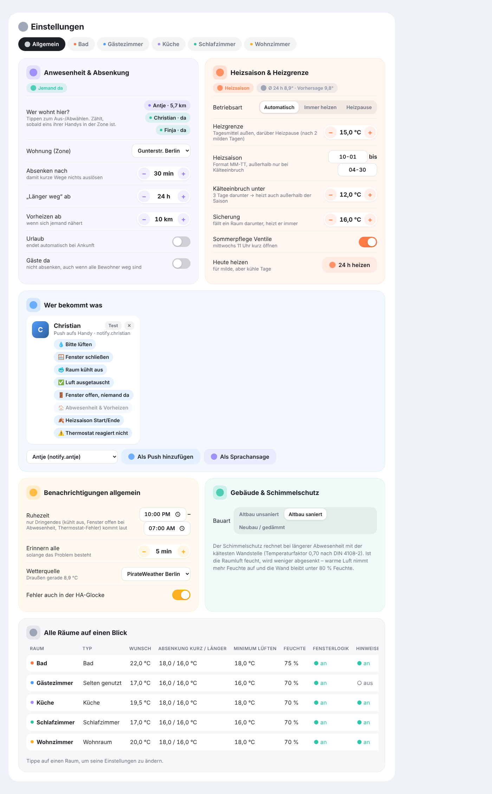
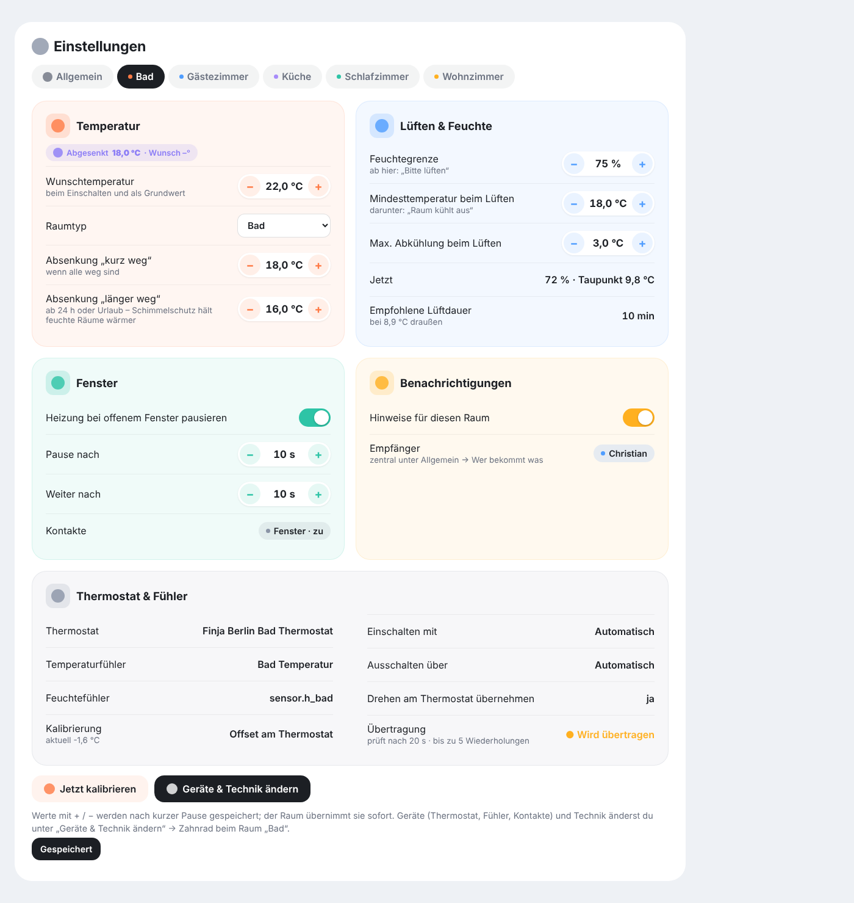
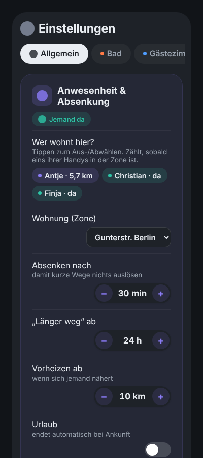

# Usage

## “Rooms” tab


**Overview at the top:** all rooms as tiles with current temperature, target, humidity and status. The chips show how many rooms are heating, open windows, notices, the sync status, who is home and whether it is heating season or a heating pause.

**Room card:**
- The **arc** shows the current temperature, the **knob** the target. **−/+** in 0.5 °C steps, **⏻** turns the room on/off.
- Below the temperature you see what currently applies: *Target 20 °C*, *Set back 18 °C · desired 20°*, *Heating paused*, *Frost protection* or *Sun helps*.
- While airing, a **countdown** runs with the recommended airing time.
- The tiles show humidity, CO₂ (if a sensor is configured), dew point, valve position, outdoor climate, radiator temperature and offset.

## “History” tab


- **Weather** across the full width at the top.
- **Room temperature** and **humidity** as curves per room, comfort range as a band (19–22 °C or 40–60 %). Toggle rooms via their chips, period 6 h / 24 h / 7 days, values on hover.
- **Heating & windows:** timeline per room – heating, reached, set back, window open, off, heating paused. Short changes while regulating are merged.

## “Report” tab


Every minute the integration records what each room does – compactly summarised per day, kept for 400 days, without burdening the Home Assistant database. The report shows **this week** or **this month**:

- **Heating hours** and how long the valves were fully open, converted (a measure of heat delivered).
- **Weather-adjusted:** heating demand per heating degree day compared with the previous week/month. A cold month doesn't make the figure worse; in very mild weather (below 5 heating degree days) there is no comparison.
- **Set back** (hours and by how many degrees) and **saved** – estimated with the rule of thumb ≈ 6 % per degree.
- **Comfort time:** share of time the room was within ±1 °C of the target.
- **Heating demand per day:** stacked bars per room, dots = heating degree days.
- **Rooms:** heated, set back, average temperature and humidity, hours too humid or with mould risk, warm on arrival.
- **Health:** open problems (see below).
- **CSV:** the button at the top right downloads all daily values per room as a table (semicolon-separated with decimal comma, as used in German spreadsheets).

### Health check

Every 10 minutes the integration checks each room:

| Check | Reports when … |
|---|---|
| Battery | thermostat, sensor or contact below 20 % (urgent below 10 %) |
| Room doesn't warm up | valve open ≥ 60 % on average for 2 h, but the room is < 0.3 °C warmer and still below target – bleed the radiator, check the valve pin or the flow temperature |
| Radiator can't keep up | over 24 h (at least 8 h of heating) the valve was ≥ 90 % open more than half the time and the target was reached less than 30 % of the time – hints at missing hydraulic balancing, a flow temperature that is too low or a radiator that is too small (notice only, no push) |
| Sensor stuck | sensor value unchanged for 12 h although the thermostat measures a change of ≥ 1.5 °C |
| Sensor missing | the room sensor hasn't reported for a long time |
| Radio | commands not confirmed (urgent) or ≥ 3 dropouts in 24 h; if all thermostats drop out at the same time, it is reported once as a connection problem (Zigbee2MQTT/MQTT/VPN) |
| Window contact | unreachable for 2 h; notice if a window has been open for more than 24 h |
| Endless loop | thermostat and integration keep changing each other (more than 40 commands in 10 min) – the integration pauses for 15 min |

Problems appear in the report, under *Settings → General → Heating health*, in the room tab (with a warning icon), in the sensor **Raumklima Allgemein Health** (number of open problems) and on the room's problem sensor. Whoever subscribed to “🩺 Health” gets a push – at most once a day per problem.

## “Log” tab


Every decision appears here live with its reason, for example:

- *Presence: someone home → briefly away* – why: who is how far away, since when nobody is home.
- *Location of Christian ignored* – jump to 431 km, too fast for real movement (VPN).
- *Living room: target 18.0 °C* – everyone away, setback “briefly away”.
- *Heating mode: heating → paused* – with the outdoor means and the heating limit.
- *Guest room: window open – night airing* – bedroom, within the time window, someone home.
- every message with its recipients and whether it was quiet, normal or urgent.
- thermostat commands (setpoint, offset) and whether they were confirmed.

Filter by room and category at the top or search for a word. *Thermostat commands* are hidden initially because the offset is adjusted often. Entries are kept for 14 days, independent of the Home Assistant database; the diagnostics export contains the last 300 entries.

> The log texts are generated by the integration and are in German.

## “Settings” tab


Here **everything is visible and can be changed directly**:

**General**
- *Presence & setback:* tap residents, choose the zone, delay, “away longer”, preheating, vacation, guests, calendar. You see who is home and how far away the others are.
- *Heating season & limit:* mode, heating limit, season period, cold snap, safety minimum, frost night, summer valve exercise, **Heat today**. Above it the current outdoor mean and the forecast.
- *Who gets what:* tap the message types per recipient, send a **Test**, add or remove recipients (push or voice).
- *Notifications – general:* quiet hours (weekend separately), night airing window, reminder interval, weather source, errors in the HA notification bell.
- *Sleep times:* learning on/off, public holidays (German state), sleep signals, learned times.
- *Building & mould protection:* building type.
- *Home:* name and dashboard of the home, create another home.
- *All rooms at a glance:* table; tap to open the room.



**Per room:** desired temperature, room type, home, setback values, sunny side, heat-up time, humidity limit, minimum temperature and maximum cooling while airing, window logic and delays, night airing, window detection without contact, **light signal** (lights, colours, test), notices on/off, calibrate. Devices and technical settings via *Change devices & technical settings*.



On a phone, labels and controls are stacked:



Changes are saved after a short pause and applied by the room right away (only changing the room type restarts the room briefly). Only administrators can change settings; other users get a read-only view.

**Language:** the cards follow the language of your Home Assistant profile – English or German.

## Several homes

Under *Settings → General → Home* you can create another home (e.g. a holiday flat). It gets its own hub with its own residents, zone, recipients, heating season, sleep times, report and log. Assign rooms in the room tab under *Home*.

A switcher then appears at the top of the overview and the settings. Each home has its own dashboard; set its path under *Home → Dashboard*. For your own dashboards: add `home: <entry_id of the hub>` to each card or to the strategy (`strategy: {type: custom:raumklima, home: …}`).

## Cards for your own dashboards

```yaml
type: custom:raumklima-overview-card   # all rooms + outdoor climate
title: Heating
strip_prefix: My Flat                  # optional: remove a prefix from the names
---
type: custom:raumklima-card            # one room
entity: climate.living_room
---
type: custom:raumklima-report-card     # heating report
---
type: custom:raumklima-log-card        # decision log (optional entity: one room only)
---
type: custom:raumklima-history-card    # history
mode: temperature                      # temperature | humidity | timeline
hours: 24
---
type: custom:raumklima-settings-card   # settings (best as a panel view)
```
