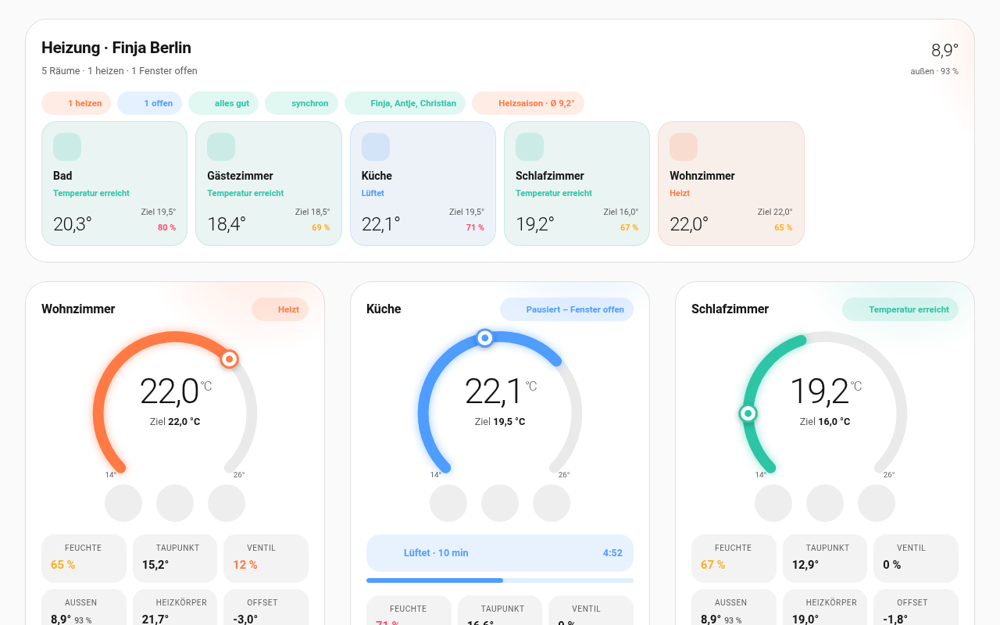
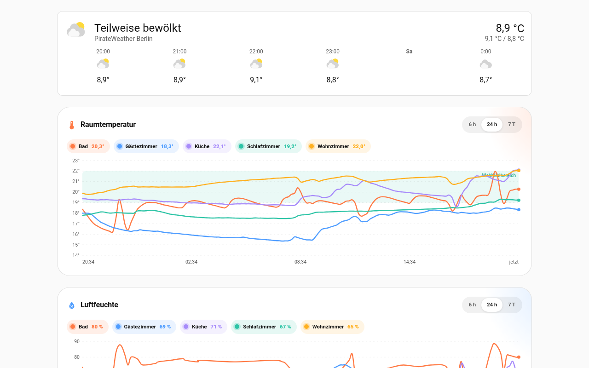
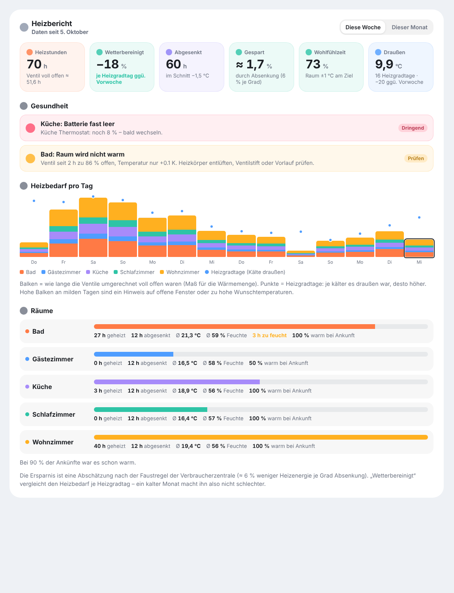
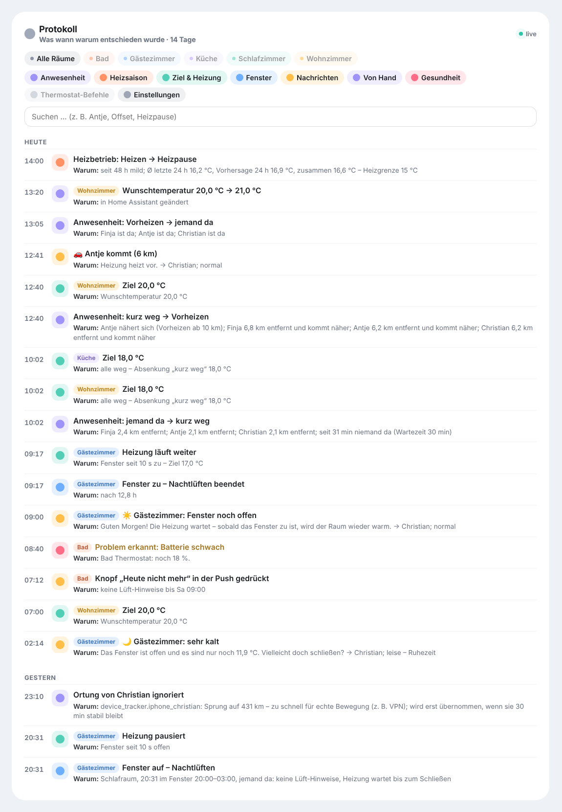
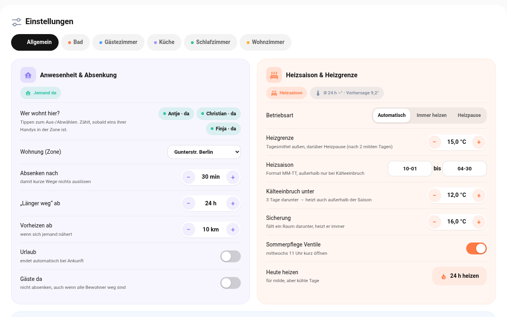
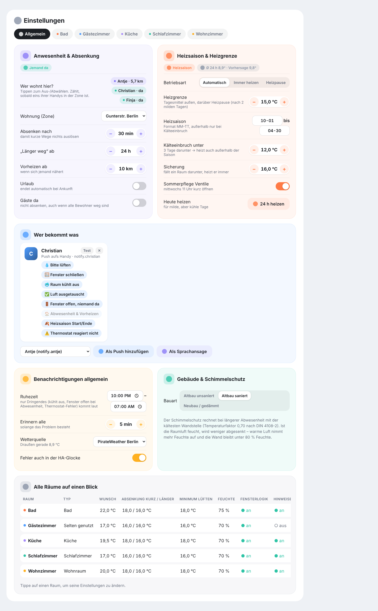
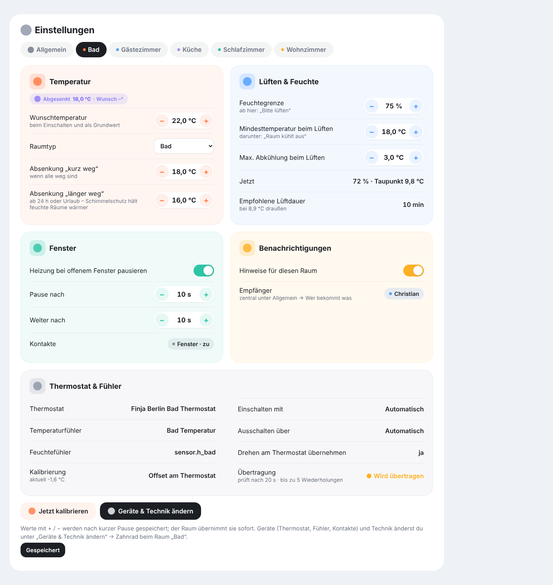
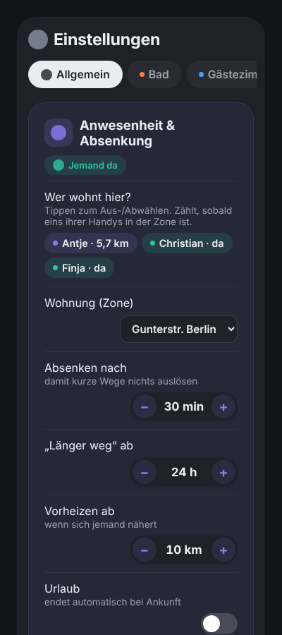

# Utilisation

## Onglet « Pièces »



**Aperçu en haut :** toutes les pièces sous forme de tuiles avec la température actuelle, la consigne, l’humidité et l’état. Les puces indiquent combien de pièces chauffent, les fenêtres ouvertes, les notifications, l’état de synchronisation, qui est présent et si l’on est en saison de chauffage ou en pause de chauffage.

**Carte de pièce :**
- L’**arc** indique la température actuelle, le **curseur** la consigne. **−/+** par pas de 0,5 °C, **⏻** allume/éteint la pièce.
- Sous la température, vous voyez ce qui s’applique actuellement : *Consigne 20 °C*, *Abaissé 18 °C · souhaitée 20°*, *Chauffage en pause*, *Protection contre le gel* ou *Soleil aidant*.
- Avec des détecteurs de présence, **« Quelqu’un dans la pièce »** ou **« Pièce vide depuis 25 min »** (ou « – abaissé ») apparaît sous le nom ; dans l’aperçu, une icône de personne marque les pièces occupées.
- Quand une fenêtre est ouverte, **« Fenêtre ouverte depuis 14:32 · 12 min »** apparaît sous le nom – la durée s’incrémente en direct. Dans l’aperçu, la tuile affiche la durée à côté de l’icône de fenêtre.
- Pendant l’aération, un **compte à rebours** s’écoule avec la durée d’aération recommandée.
- Les tuiles affichent l’humidité, le CO₂ (si une sonde est configurée), le point de rosée, la position de la vanne, le climat extérieur, la température du radiateur et le décalage.

## Onglet « Historique »



- **Météo** sur toute la largeur en haut.
- **Température de la pièce** et **humidité** sous forme de courbes par pièce, plage de confort sous forme de bande (19–22 °C ou 40–60 %). Affichez/masquez les pièces via leurs puces, période 6 h / 24 h / 7 jours, valeurs au survol.
- **Chauffage et fenêtres :** chronologie par pièce – chauffage, consigne atteinte, abaissé, fenêtre ouverte, éteint, chauffage en pause. Les changements courts pendant la régulation sont fusionnés.

## Onglet « Rapport »



Chaque minute, l’intégration enregistre ce que fait chaque pièce – résumé de façon compacte par jour, conservé 400 jours, sans alourdir la base de données de Home Assistant. Le rapport affiche **cette semaine** ou **ce mois** :

- **Heures de chauffage** et durée pendant laquelle les vannes ont été complètement ouvertes, converties (une mesure de la chaleur fournie).
- **Corrigé des conditions météo :** besoin de chauffage par degré-jour de chauffage, comparé à la semaine/au mois précédent. Un mois froid ne dégrade pas la valeur ; par temps très doux (moins de 5 degrés-jours de chauffage), il n’y a pas de comparaison.
- **Abaissement** (heures et de combien de degrés) et **économie** – estimée avec la règle empirique ≈ 6 % par degré.
- **Temps de confort :** part du temps pendant laquelle la pièce était à ±1 °C de la consigne.
- **Besoin de chauffage par jour :** barres empilées par pièce, points = degrés-jours de chauffage.
- **Pièces :** chauffée, abaissée, température et humidité moyennes, heures trop humides ou avec risque de moisissures, chaude à l’arrivée.
- **Santé :** problèmes ouverts (voir ci-dessous).
- **CSV :** le bouton en haut à droite télécharge toutes les valeurs journalières par pièce sous forme de tableau (séparé par des points-virgules avec virgule décimale, comme dans les tableurs allemands).

### Rapports PDF

En bas du rapport de chauffage, vous trouvez les **rapports PDF** – chacun avec un bouton **Télécharger**, vous n’avez donc jamais besoin d’ouvrir un dossier. Il en existe trois types :

| Rapport | automatiquement | période |
|---|---|---|
| Semaine | dimanches à 18:00 | lundi à dimanche |
| Mois | le 1er à 9:00 | le mois précédent |
| Saison de chauffage | le jour après la fin de la saison (par défaut le 1er mai) | saison entière, p. ex. 1er oct. – 30 avr. |

Les boutons **Semaine**, **Mois** et **Saison de chauffage** créent immédiatement un rapport **jusqu’à aujourd’hui** et le téléchargent.

**Contenu (4 pages) :**

| Page | Ce qu’elle contient |
|---|---|
| 1 | **Note Raumklima A–F** (à partir du temps de confort, de l’humidité et des économies) avec l’historique des dernières semaines/mois · heures de chauffage, économies (éventuellement **en euros**), temps de confort, température extérieure · comparaison avec la période précédente et l’**année précédente**, également corrigée des conditions météo · graphique des heures de chauffage et de la température extérieure |
| 2 | **Pièces** avec de petites **courbes de tendance** pour la température et l’humidité · **classement** (pièce la plus économe et la plus chaude, meilleur temps de confort, plus grosse amélioration) · **jours de semaine vs. week-end** |
| 3 | **Humidité et moisissures** sous forme de feu tricolore par pièce, pièce à problème, **CO₂** (moyenne et heures au-dessus de 1000 ppm) · **résumé des aérations** (fréquence, durée, entrebâillée > 30 min, « veuillez aérer » → « air renouvelé ») · **carte de chaleur** « Quand chauffe-t-on ? » – jour de semaine × heure |
| 4 | **Présence** (personne à la maison, préchauffée, chaude à l’arrivée, occupation de la pièce, temps de montée en température par pièce) · **fiabilité** (pannes, coupures de connexion, **niveaux de piles**) · dans le rapport de saison, un **bilan** (premier/dernier jour de chauffage, jour le plus froid, plus longue pause, mois de pointe) · **conseils d’économie** avec chiffres · **constats** |

**Estimation en euros :** sous *Réglages → Général → Rapports → Autres réglages → Coûts de chauffage par an*, saisissez les coûts de votre facture (facultatif). Le rapport estime alors les économies en euros et ce qu’apporte 1 °C de moins par an – approximativement via les degrés-jours de chauffage, sans compteur. Laisser vide = pas de chiffres en euros.

La carte de chaleur, le CO₂, les résultats d’aération et les pannes sont collectés à partir de la version 0.13 – ils se remplissent au fil du temps.

**Langue :** comme Home Assistant – allemand, français, toute autre langue obtient l’anglais.

**Livraison :**
- **Push** à tous ceux qui reçoivent le *rapport hebdomadaire* – avec un bouton **Ouvrir le PDF** (lien valable 30 jours).
- **E-mail avec pièce jointe :** sous *Réglages → Général → Rapports → PDF par e-mail*, appuyez juste en dessous sur **Configurer l’e-mail** : choisissez votre fournisseur (Gmail, GMX, WEB.DE, 1&1, Outlook, T-Online, iCloud, Posteo, IONOS – remplit le serveur et le port), saisissez utilisateur, mot de passe et destinataires. **Vérifier la connexion** teste le serveur, le chiffrement et la connexion sans envoyer d’e-mail ; puis **Enregistrer et envoyer un e-mail de test**. Gmail, iCloud et Outlook nécessitent un **mot de passe d’application**. Le mot de passe reste dans Home Assistant et n’est jamais affiché. Si vous disposez déjà d’un service de messagerie (`notify`) dans Home Assistant, vous pouvez le choisir à la place.
- **Stockage :** dans le dossier media sous `raumklima/` – également visible sous *Média* dans Home Assistant. Les 26 derniers rapports hebdomadaires, 24 mensuels et 20 de saison sont conservés.

Quels rapports sont créés automatiquement se règle sous *Rapports PDF* (par défaut : les trois). Le téléchargement ne fonctionne qu’une fois connecté ou avec un lien signé.

### Contrôle de santé

Toutes les 10 minutes, l’intégration vérifie chaque pièce :

| Vérification | Signale quand … |
|---|---|
| Pile | thermostat, sonde ou contact en dessous de 20 % (urgent en dessous de 10 %) |
| La pièce ne chauffe pas | vanne ouverte ≥ 60 % en moyenne pendant 2 h, mais la pièce est < 0,3 °C plus chaude et toujours en dessous de la consigne – purgez le radiateur, vérifiez la tige de la vanne ou la température de départ |
| Le radiateur ne suit pas | sur plus de 24 h (au moins 8 h de chauffage), la vanne était ouverte à ≥ 90 % plus de la moitié du temps et la consigne a été atteinte moins de 30 % du temps – indique un équilibrage hydraulique manquant, une température de départ trop basse ou un radiateur trop petit (notification uniquement, pas de push) |
| Sonde bloquée | valeur de la sonde inchangée pendant 12 h alors que le thermostat mesure un changement de ≥ 1,5 °C |
| Sonde manquante | la sonde de la pièce n’a rien signalé depuis longtemps |
| Radio | commandes non confirmées (urgent) ou ≥ 3 décrochages en 24 h ; si tous les thermostats décrochent en même temps, cela est signalé une fois comme problème de connexion (Zigbee2MQTT/MQTT/VPN) |
| Contact de fenêtre | injoignable pendant 2 h ; notification si une fenêtre est ouverte depuis plus de 24 h |
| Boucle sans fin | thermostat et intégration se modifient mutuellement en continu (plus de 40 commandes en 10 min) – l’intégration se met en pause 15 min |

Les problèmes apparaissent dans le rapport, sous *Réglages → Général → Santé du chauffage*, dans l’onglet de la pièce (avec une icône d’avertissement), dans la sonde **Raumklima Allgemein Health** (nombre de problèmes ouverts) et sur la sonde de problème de la pièce. Celui qui s’est abonné à « 🩺 Santé » reçoit un push – au plus une fois par jour et par problème.

## Onglet « Journal »



Chaque décision apparaît ici en direct avec sa raison, par exemple :

- *Présence : quelqu’un à la maison → brièvement absent* – pourquoi : qui est à quelle distance, depuis quand personne n’est à la maison.
- *Position d’une personne ignorée* – saut de 431 km, trop rapide pour un déplacement réel (VPN).
- *Salon : consigne 18,0 °C* – tout le monde absent, abaissement « brièvement absent ».
- *Mode de chauffage : chauffage → pause* – avec les moyennes extérieures et la limite de chauffage.
- *Chambre d’amis : fenêtre ouverte – aération nocturne* – chambre à coucher, dans la plage horaire, quelqu’un à la maison.
- chaque message avec ses destinataires et s’il était silencieux, normal ou urgent.
- les commandes du thermostat (consigne, décalage) et si elles ont été confirmées.

Filtrez par pièce et par catégorie en haut ou recherchez un mot. Les *commandes du thermostat* sont masquées au départ, car le décalage est ajusté souvent. Les entrées sont conservées 14 jours, indépendamment de la base de données de Home Assistant ; l’export de diagnostic contient les 300 dernières entrées.

> Les textes du journal sont générés par l’intégration dans la langue système de Home Assistant (allemand, français, sinon anglais) ; les entrées plus anciennes conservent leur langue.

## Onglet « Réglages »



Ici, **tout est visible et modifiable directement** :

**Général**
- *Présence et abaissement :* touchez les habitants, choisissez la zone, le délai, « absent plus longtemps », le préchauffage, les vacances, les invités, le calendrier. Vous voyez qui est à la maison et à quelle distance se trouvent les autres.
- *Saison de chauffage et limite :* mode, limite de chauffage, période de la saison, coup de froid, minimum de sécurité, nuit de gel, exercice des vannes en été, **Chauffer aujourd’hui**. Au-dessus, la moyenne extérieure actuelle et la prévision.
- *Qui reçoit quoi :* touchez les types de messages par destinataire, envoyez un **Test**, ajoutez ou supprimez des destinataires (push ou voix).
- *Notifications – général :* conseils d’aération de–à, seulement aux personnes présentes, alerte tempête et pluie ; replié : intervalle de rappel, erreurs dans la cloche de notification de HA.
- *Rapports :* rapports PDF, PDF par e-mail ; replié : mesure de chaleur dans le rapport, coûts de chauffage par an.
- *Nuit et heures calmes :* heures calmes (week-end séparément), aération nocturne, apprendre les horaires, **travail posté** (sommeil de jour aussi), **l’heure de repos abaisse**, jours fériés, signaux de sommeil – en dessous, ce qui a été appris.
- *Logement :* nom, type de bâtiment, source météo ; replié : tableau de bord, emplacement, autre logement.

Les lignes rarement utilisées se trouvent dans chaque groupe sous **Autres réglages** (le nombre indique combien). Le volet s’ouvre de lui-même dès qu’une valeur diffère de la valeur par défaut – un point le signale. La recherche ouvre les résultats, et **Vue expert** en haut à droite garde tout déplié.
- *Maison :* nom et tableau de bord de la maison, créer une autre maison.
- *Toutes les pièces en un coup d’œil :* tableau ; touchez pour ouvrir la pièce.



**Par pièce :** température souhaitée, type de pièce, maison, valeurs d’abaissement, côté ensoleillé, temps de montée en température, limite d’humidité, température minimale et refroidissement maximal pendant l’aération, logique et délais de fenêtre, aération nocturne, détection de fenêtre sans contact, **détecteurs de présence** (sondes, type, abaisser la pièce vide), **signal lumineux** (lampes, couleurs, test), notifications activées/désactivées, calibrer. Appareils et réglages techniques via *Modifier les appareils et réglages techniques*.



Sur un téléphone, les libellés et les commandes sont empilés :



Chaque réglage a un **« ? »** – touchez-le pour ouvrir une brève explication de son rôle et de la valeur pertinente.

Les modifications sont enregistrées après une courte pause et appliquées par la pièce immédiatement (seul le changement du type de pièce redémarre brièvement la pièce). Seuls les administrateurs peuvent modifier les réglages ; les autres utilisateurs obtiennent une vue en lecture seule.

**Langue :** les cartes suivent la langue de votre profil Home Assistant – anglais, allemand ou français.

## Planning et boost

**Des heures de chauffe fixes** se règlent par pièce dans les réglages : *Réglages → pièce → **Planning →
Ajouter une plage horaire***. Une plage horaire a des jours de la semaine (aucun choix = tous les jours), de/à
et une température cible ; jusqu’à 30 plages par pièce (toucher une heure ouvre le sélecteur au quart d’heure ; saisir des minutes exactes comme 06:50 en dessous), y compris au-delà de minuit (p. ex. 22:00–06:00). Si
deux plages se chevauchent, la plus basse s’applique. Exemple : « salon tous les jours 19–21 h 22 °C, sinon
20 °C » – réglez la température souhaitée sur 20 °C et ajoutez une plage 19–21 h à 22 °C.

Important : le planning ne règle **que la consigne**. La fenêtre ouverte met toujours en pause, la protection
contre le gel et les moisissures reste active, rien ne chauffe pendant la pause de chauffage – et si personne
n’est là, l’abaissement l’emporte. La carte indique quand un planning s’applique (« Planning · cible 22,0 °C »).

**Boost (« plus chaud un moment ») :** Le bouton **Plus chaud** de la carte de pièce (ou
`button.<room>_wärmer_boost`) chauffe plus fort pendant une durée fixe – pratique avant la douche. Le surplus et
la durée se règlent sous *Planning* (2 K / 30 min par défaut). La carte affiche le temps restant pendant le
boost ; un second appui l’arrête aussitôt. Le boost s’applique même quand la pièce serait abaissée.

**Préchauffage :** Pour que la pièce soit déjà chaude au début d’une plage, Raumklima déduit de la vitesse
de chauffe apprise quand commencer et démarre à temps (10 minutes de marge). La carte affiche alors
« Préchauffage pour le planning ». Cela n’arrive que si quelqu’un est à la maison et que la pièce a déjà
appris sa vitesse de chauffe – elle progresse à chaque chauffe, rien à régler.

## Plusieurs maisons

Sous *Réglages → Général → Maison*, vous pouvez créer une autre maison (p. ex. un appartement de vacances). Elle obtient son propre hub avec ses propres habitants, zone, destinataires, saison de chauffage, heures de sommeil, rapport et journal. Affectez les pièces dans l’onglet de la pièce sous *Maison*.

Un sélecteur apparaît alors en haut de l’aperçu et des réglages. Chaque maison a son propre tableau de bord ; définissez son chemin sous *Maison → Tableau de bord*. Pour vos propres tableaux de bord : ajoutez `home: <entry_id du hub>` à chaque carte ou à la stratégie (`strategy: {type: custom:raumklima, home: …}`). Le **nom de la maison** fonctionne aussi (`home: résidence secondaire`). Attention pour les tableaux de bord construits à la main : **sans** `home:`, une carte affiche toutes les pièces – y compris celles d’une autre maison. Les pièces sans maison apparaissent partout ; réglez-la sous *Pièce → Maison*.

## Cartes pour vos propres tableaux de bord

```yaml
type: custom:raumklima-overview-card   # toutes les pièces + climat extérieur
title: Chauffage
strip_prefix: Mon appartement          # facultatif : retirer un préfixe des noms
---
type: custom:raumklima-card            # une pièce
entity: climate.living_room
---
type: custom:raumklima-report-card     # rapport de chauffage
---
type: custom:raumklima-log-card        # journal des décisions (entity facultatif : une seule pièce)
---
type: custom:raumklima-history-card    # historique
mode: temperature                      # temperature | humidity | timeline
hours: 24
---
type: custom:raumklima-settings-card   # réglages (de préférence en vue panneau)
```
