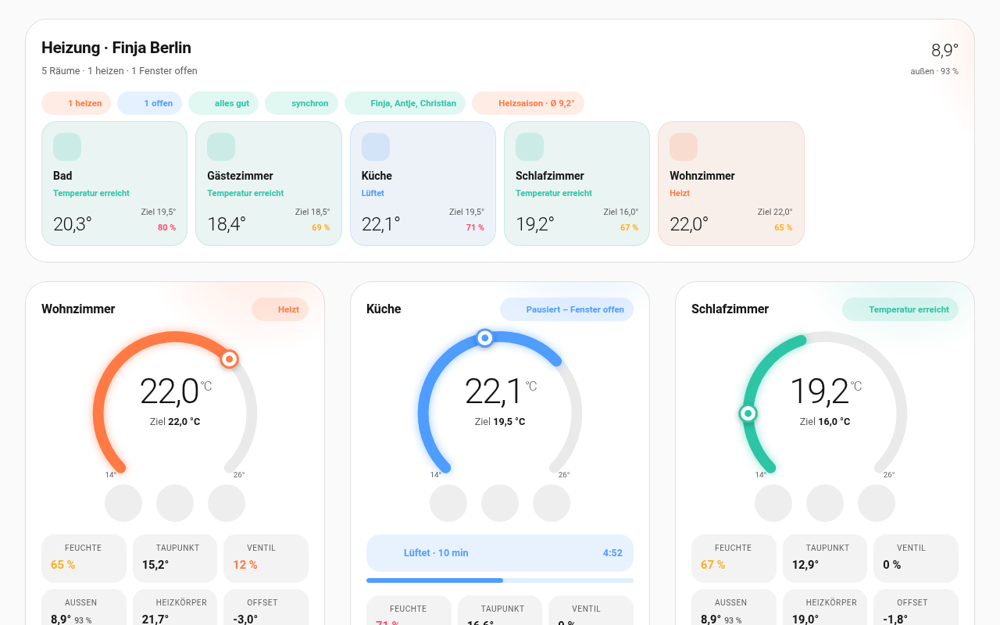
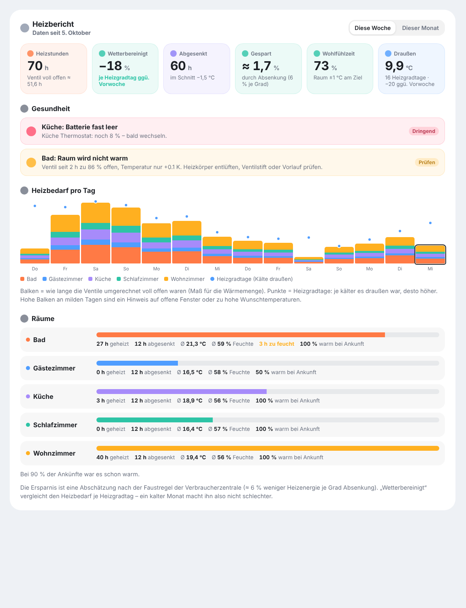
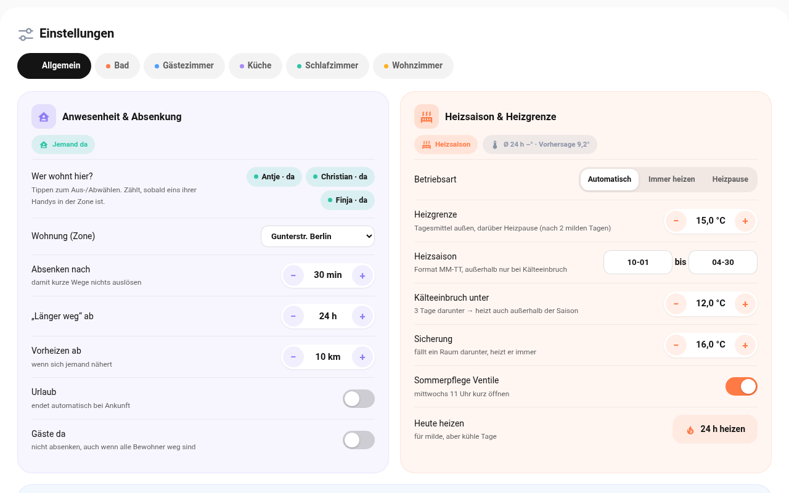

# Willkommen

**Raumklima** macht aus jedem Heizkörperthermostat ein Raumthermostat, das mitdenkt. Es regelt nach einem echten Fühler im Raum, macht beim Lüften Pause, senkt ab, wenn niemand zu Hause ist, und heizt im Sommer gar nicht erst.

Dieses Handbuch erklärt Schritt für Schritt, wie du Raumklima einrichtest und im Alltag nutzt. Technisches Vorwissen brauchst du nicht – nur ein laufendes Home Assistant.

:::tip
**Kurz gesagt:** Einmal einrichten, dann läuft alles von selbst. Du musst nur noch eingreifen, wenn du etwas anders haben möchtest.
:::

## Was Raumklima für dich tut

| | |
|---|---|
| 🌡️ **Richtig messen** | Regelt nach einem Fühler mitten im Raum statt nach dem Thermostat direkt am heißen Heizkörper. |
| 🪟 **Fenster auf = Pause** | Ist ein Fenster offen, hört die Heizung auf. Danach geht es mit der alten Einstellung weiter. |
| 💨 **Lüften mit Plan** | Sagt Bescheid, wenn die Luft feucht oder verbraucht ist, wie lange gelüftet werden soll und wann es reicht. |
| 🏠 **Niemand da = sparen** | Senkt ab, wenn alle weg sind, und heizt vor, bevor jemand nach Hause kommt. |
| 🧱 **Schimmelschutz** | Senkt nie so weit ab, dass die Wände feucht werden. |
| 🍂 **Nur heizen, wenn es kalt ist** | Erkennt anhand der Wettervorhersage, ob überhaupt geheizt werden muss. |
| 📱 **Gute Nachrichten** | Schickt Hinweise aufs Handy – nachts leise. Auf Wunsch mit Lüft-Countdown auf dem Sperrbildschirm. |
| 💡 **Lichtsignal** | Lampen im Raum blinken blau, wenn gelüftet werden soll, und orange, wenn das Fenster zu soll. |
| 📈 **Bericht** | Zeigt, wie viel geheizt und gespart wurde. |

## Was du brauchst

- **Home Assistant** (Version 2025.10 oder neuer) mit **HACS**
- pro Raum ein (oder mehrere) **Heizkörperthermostat**, das in Home Assistant erscheint – egal ob Zigbee, Shelly, Matter oder Cloud
- pro Raum einen **Temperaturfühler** (am besten mit Luftfeuchte)
- optional: **Fensterkontakte**, ein **CO₂-Sensor**, ein **Feinstaubfühler** (PM2,5)
- für die Anwesenheit: die **Home-Assistant-App** auf euren Handys

# Einrichten

## Schritt 1: Installieren

1. Öffne in Home Assistant **HACS**.
2. Tippe oben rechts auf **⋮ → Benutzerdefinierte Repositories**.
3. Trage `https://github.com/Goldi5/Raumklima-2` ein, Kategorie **Integration**, und bestätige.
4. Suche in HACS nach **Raumklima** und tippe auf **Herunterladen**.
5. **Starte Home Assistant neu** (*Einstellungen → System → Neu starten*).

:::tip
Schalte vorher die eingebaute Fenstererkennung deines Thermostats aus (falls es eine hat) und deaktiviere alte Automationen für dieselben Thermostate. Sonst arbeiten beide gegeneinander.
:::

## Schritt 2: Den ersten Raum anlegen

Gehe zu **Einstellungen → Geräte & Dienste → Integration hinzufügen** und wähle **Raumklima**.

Du siehst drei Wege: **Raum ergänzen**, **Überwachung** (Raum ohne Thermostat – nur messen, anmahnen,
berichten) und **Neue Wohnung**. Für den Anfang: *Raum ergänzen*.

1. **Thermostat wählen** – das Thermostat am Heizkörper.
2. **Fühler & Fenster** – Raumklima schlägt Fühler und Fensterkontakte aus demselben Raum vor. Kurz prüfen, weiter. Hat der Raum **mehrere Heizkörper**, die übrigen Thermostate bei **Weitere Thermostate im Raum** auswählen. Fensterkontakte gehen beliebig viele.
3. **Der Raum** – wähle den **Raumtyp** (Wohnzimmer, Schlafzimmer, Bad …). Damit sind alle Werte schon sinnvoll eingestellt. Die Technik unter *Erweitert* kannst du in Ruhe lassen.
4. **Für die ganze Wohnung** (nur beim ersten Raum) – wer wohnt hier, welche Zone ist die Wohnung, wer bekommt Nachrichten, woher kommt das Wetter.

Für jeden weiteren Raum wiederholst du das – nur Schritt 4 entfällt.

## Schritt 3: Das Dashboard

Raumklima bringt ein fertiges Dashboard mit. So holst du es dir:

1. Öffne **Einstellungen → Dashboards**.
2. Tippe unten rechts auf **+ Dashboard hinzufügen**.
3. Wähle in der Liste **Raumklima** und tippe auf **Weiter**.
4. Gib ihm einen Namen (z. B. „Heizung“) und ein Symbol, dann **Erstellen**.

Das neue Dashboard erscheint links in der **Seitenleiste**. Es baut sich von selbst auf, mit den Reitern *Räume*, *Verlauf*, *Bericht*, *Protokoll* und *Einstellungen* – und wächst mit, wenn du Räume hinzufügst.

:::tip
**Raumklima steht nicht in der Liste?** Lade die Seite neu (am Computer **Strg + F5**, in der App: *Einstellungen → Companion App → Frontend-Cache zurücksetzen*). Die Karten werden beim Start von Home Assistant geladen.
:::

### Karten im eigenen Dashboard

Du möchtest die Raumklima-Karten lieber in dein bestehendes Dashboard einbauen? Das geht so:

1. Öffne dein Dashboard und tippe oben rechts auf den **Stift** (Bearbeiten).
2. Tippe auf **+ Karte hinzufügen**.
3. Gib im Suchfeld **Raumklima** ein.
4. Wähle eine Karte aus und tippe auf **Speichern**.

| Karte | Zeigt |
|---|---|
| **Raumklima – Übersicht** | alle Räume, Außentemperatur, wer zu Hause ist |
| **Raumklima – Raum** | einen Raum mit Temperatur, Bedienung und Lüften (Raum im Editor auswählen) |
| **Raumklima – Verlauf** | Temperatur, Luftfeuchte oder Zeitleiste aller Räume |
| **Raumklima – Heizbericht** | Woche und Monat, Ersparnis, Gesundheit |
| **Raumklima – Protokoll** | was wann warum passiert ist |
| **Raumklima – Einstellungen** | alle Einstellungen – am besten als eigene Seite in voller Breite |

## Die ersten 10 Minuten

Nimm dir nach der Einrichtung kurz Zeit für diese Punkte. Alles findest du im Dashboard im Reiter **Einstellungen → Allgemein**.

:::check
- **Bewohner antippen** – wer wohnt hier?
- **Zone wählen** – welche Zone ist eure Wohnung?
- **Empfänger hinzufügen** – wer bekommt Nachrichten? Mit **Test** prüfen.
- **Wetterquelle wählen** – z. B. `weather.forecast_home`.
- **Wunschtemperaturen prüfen** – pro Raum im jeweiligen Reiter.
:::

# Im Alltag

## Die Raumkarte lesen

- Der **Bogen** zeigt, wie warm es gerade ist, der **Punkt** das Ziel.
- Mit **− / +** stellst du die Wunschtemperatur in halben Grad ein, mit **⏻** schaltest du den Raum aus und an.
- Ist ein Fenster offen, steht unter dem Namen **„Fenster offen seit 14:32 · 12 min“**. In der Übersicht oben siehst du die Dauer neben dem Fenster-Symbol jedes Raums.
- Oben rechts steht, was der Raum gerade macht:

| Anzeige | Bedeutung |
|---|---|
| **Heizt** | Der Raum ist kälter als gewünscht und wird geheizt. |
| **Temperatur erreicht** | Alles gut, es ist warm genug. |
| **Pausiert – Fenster offen** | Ein Fenster ist offen, die Heizung wartet. |
| **Nachtlüften – Fenster offen** | Jemand schläft bei offenem Fenster. |
| **Abgesenkt – niemand da** | Alle sind weg, es wird gespart. |
| **Heizpause** | Draußen ist es mild genug. |
| **Aus** | Du hast den Raum ausgeschaltet. |
| **Fühler ausgefallen** | Der Fühler meldet sich nicht – das Thermostat regelt allein weiter. |
| **Thermostat nicht erreichbar** | Funk- oder Batterieproblem. |
| **Überwachung** | Raum ohne Thermostat – es wird nur gemessen und erinnert. |
| **Thermostat 16,5° (Abgleich −1,3°)** | Das Gerät bekommt einen um den Fühler-Versatz tieferen Sollwert; im Raum gilt weiter dein Ziel. |

## Lüften

Wird die Luft zu feucht (oder mit CO₂-Sensor: verbraucht), bekommst du **„Bitte lüften“**. Öffnest du das Fenster, läuft in der Karte ein **Countdown** mit der empfohlenen Lüftdauer – im Winter nur wenige Minuten.

- **„Luft ausgetauscht“** – du kannst schließen.
- **„Lüftzeit erreicht“** – bitte schließen.
- **„Raum kühlt aus“** – jetzt aber wirklich schließen.

Die Nachrichten haben Knöpfe: **Erledigt**, **In 15 min erinnern** und **Heute nicht mehr**.

:::tip
Lüften lohnt sich nur, wenn die Luft draußen trockener ist. Raumklima rechnet das aus und bittet dich bei feuchtem Wetter gar nicht erst ums Lüften.
:::

### Feinstaub (PM2,5)

Hat ein Raum einen Feinstaubfühler, kommt er als eigene Kachel dazu. Ab **35 µg/m³** bittet Raumklima
zu lüften, unter **15 µg/m³** gilt die Luft als ausgetauscht. Anders als bei der Feuchte gibt es keine
Wartezeit: Feinstaub steigt beim Kochen, bei Kerzen oder Rauch sofort.

### Raum ohne Heizung (Überwachung)

Manche Räume haben kein Thermostat – Flur, Abstellraum, Werkstatt. Für sie legst du beim Anlegen
**„Überwachung“** statt „Raum“ an: Raumklima misst dort Temperatur, Feuchte, CO₂ und Feinstaub, mahnt
Lüften an und berichtet – fasst aber **keinen Sollwert** an. Im Dashboard bekommen diese Räume eine
eigene große Karte mit denselben Messwerten, aber ohne Plus/Minus, ohne Boost und ohne Sollwert.

## Lüft-Countdown auf dem Sperrbildschirm

Mit der Home-Assistant-App siehst du den Countdown auch auf dem **Sperrbildschirm** – auf dem iPhone als Live-Aktivität (auch in der Dynamic Island), auf Android in der Benachrichtigungsleiste. Du musst das Handy nicht entsperren.

So schaltest du ihn ein:

1. Dashboard → **Einstellungen → Allgemein → Wer bekommt was**.
2. Bei deinem Handy **📱 Lüft-Countdown auf dem Sperrbildschirm** antippen.
3. Beim nächsten Lüften auf dem iPhone den Hinweis zum Sperrbildschirm bestätigen.

| Farbe | Bedeutung |
|---|---|
| 🔵 Blau, Uhr läuft | Fenster offen, so lange noch lüften |
| 🟢 Grün | Luft ausgetauscht – du kannst schließen |
| 🟠 Orange | Lüftzeit erreicht – bitte schließen |
| 🔴 Rot | Raum kühlt aus – jetzt schließen |

Ist das Fenster zu, verschwindet die Anzeige von selbst.

:::tip
**Voraussetzung:** iPhone ab iOS 17.2 und Home Assistant ab Version 2026.7. Das Handy muss Home Assistant auch unterwegs erreichen. Bleibt die Anzeige hängen: in den iPhone-Einstellungen unter *Home Assistant → Live-Aktivitäten* aus- und wieder einschalten.
:::

## Lichtsignal: Lampen zeigen es an

Nicht jeder hat das Handy in der Hand. Darum können Lampen im Raum Bescheid geben: Sie **blinken dreimal** in einer Farbe und gehen danach wieder so, wie sie vorher waren.

So richtest du es ein:

1. Dashboard → **Einstellungen** → Reiter des Raums (z. B. *Bad*).
2. Bereich **Lichtsignal** → Lampe im Auswahlfeld wählen → **Lampe hinzufügen**. Das geht auch mit mehreren Lampen.
3. Bei **Blinken bei** antippen, wann es blinken soll.
4. Mit **Test** ausprobieren – die Lampen blinken blau.

| Farbe | Wann | von Anfang an |
|---|---|---|
| 🔵 Blau | Bitte lüften | an |
| 🟠 Orange | Bitte schließen / Raum kühlt aus | an |
| 🟢 Grün | Luft ausgetauscht | aus |
| 🔴 Rot | Problem mit der Heizung | aus |

:::tip
Nachts in der Ruhezeit, beim Schlafen mit offenem Fenster und wenn niemand zu Hause ist, blinkt nichts. Lampen ohne Farbe blinken einfach hell.
:::

## Präsenzmelder: Wer ist im Raum?

Mit Präsenzmeldern weiß Raumklima nicht nur, ob jemand zu Hause ist, sondern auch, **in welchem Raum**. Es gibt zwei Arten:

| Was | **mmWave** (Radar) | **PIR** (Bewegungsmelder) |
|---|---|---|
| sieht | auch Stillsitzende und Schlafende | nur Bewegung |
| Raum gilt als leer | nach 3 Minuten | erst nach 20 Minuten |
| zählt für „jemand zu Hause“ | ja | nein (Haustiere!) – einstellbar |

**mmWave ist deutlich zuverlässiger.** PIR geht auch, Raumklima ist damit aber vorsichtiger.

So richtest du es ein:

1. Dashboard → **Einstellungen** → Reiter des Raums.
2. Bereich **Präsenzmelder** → Melder im Auswahlfeld wählen (dahinter steht mmWave oder PIR) → **Melder hinzufügen**.
3. **Leeren Raum absenken:** *Automatisch* lässt Wohnraum, Küche und selten genutzte Räume nach 30 Minuten ohne jemanden 1,5 °C kühler werden – nur mit mmWave. Mit **Ja** gilt es auch für andere Räume oder für PIR.

Die Raumkarte zeigt dann **„Jemand im Raum“** oder **„Raum leer seit 25 min“**. Kommt jemand herein, wird sofort wieder auf die Wunschtemperatur geheizt.

### Wärmer, solange jemand im Raum ist

Beispiel Arbeitszimmer: Niemand drin → 18,5 °C, jemand am Schreibtisch → 21 °C.

1. **Wunschtemperatur** (Raum → Temperatur) auf den Wert für den **leeren** Raum stellen, z. B. 18,5 °C.
2. Raum → **Anwesenheit → Präsenzmelder:** Melder hinzufügen, dann bei **Bei Anwesenheit** auf **Einschalten** tippen und die Temperatur wählen, z. B. 21 °C.
3. **… wenn belegt seit:** so lange muss jemand im Raum sein (Standard 5 min, 0–30). Kurz Durchgehen zählt nicht.
4. **… zurück nach:** so lange ohne Belegung, dann gilt wieder die Temperatur von vorher (Standard 5 min). Wer kürzer rausgeht, kommt in den warmen Raum zurück.

Es zählen nur **mmWave-Melder** – ein Bewegungsmelder sieht auch die Katze. Unter *Weitere Einstellungen* lässt sich „… auch Bewegungsmelder“ einschalten; dann „zurück nach“ eher auf 20 min stellen. Mit der Anwesenheits-Temperatur senkt *Leeren Raum absenken → Automatisch* nicht zusätzlich ab – der Wunsch ist ja schon der Wert für den leeren Raum. Oben in der Gruppe steht, was gerade gilt: „jemand da seit 3 min – ab 5 min 21 °C“ oder „heizt auf 21 °C“.

:::tip
Ein Melder im Wohnzimmer verhindert auch, dass Raumklima fälschlich „alle weg“ denkt – etwa wenn ein Handy aus ist oder Besuch allein da ist. Im Urlaub zählen die Melder nicht, die Katze beendet also nicht den Urlaub.
:::

**Vorwärmen nach gelernten Zeiten:** Raumklima merkt sich, wann der Raum belegt ist. War er an 3 der letzten 4 gleichen Wochentage zur selben Zeit belegt (z. B. Mo–Fr ab 08:00), wird vorher auf die Anwesenheits-Temperatur gewärmt – so früh, wie der Raum laut gelernter Aufheizzeit braucht. Kommt 30 Minuten nach dem üblichen Beginn niemand, gilt wieder der Wert von vorher. Was gelernt ist, steht unter dem Schalter („meist belegt: Mo–Fr 08:00–12:30“). Alte Gewohnheiten vergisst Raumklima nach vier Wochen.

**Lampen als Anwesenheit:** Unter *Weitere Einstellungen* lassen sich Lampen eintragen – eine eingeschaltete Schreibtischlampe heißt dann „jemand ist im Raum“. Das hilft in Räumen ohne mmWave-Melder. Lampen zählen nur für den Raum, nie für „jemand zu Hause“.

## Warum das Thermostat eine andere Zahl zeigt

Am Gerät steht manchmal ein anderer Sollwert als in der Karte – zum Beispiel **Ziel 18,0 °C**, am
Thermostat aber **16,5 °C**. Das ist gewollt: Das Thermostat misst direkt am Heizkörper, der Fühler im
Raum misst woanders. Liegt das Gerät 1,3 K zu kalt, regelt es ohne Korrektur so lange weiter, bis der
Raum 19,3 °C hat.

Raumklima **lernt diesen Versatz** („Abgleich“) und zieht ihn vom Sollwert ab. In der Karte steht dann
**„Thermostat 16,5° (Abgleich −1,3°)“** – dein Ziel bleibt 18,0 °C. Der Wert wird dauerhaft gespeichert
und alle 10 Minuten nachgeführt, damit er auch bei Geräten ankommt, die selten melden (Livisi, Homematic IP).

## Welcher Stand läuft?

Unter der Räume-Zeile in der Übersicht steht klein die Version, z. B. **„Raumklima 0.45.2“**. Das hilft,
wenn eine Änderung nicht anzukommen scheint: Erst prüfen, ob die Karte den neuen Stand geladen hat.

## Wenn alle weg sind

Raumklima merkt über eure Handys, wenn niemand mehr zu Hause ist:

| Situation | Was passiert |
|---|---|
| Alle seit 30 Minuten weg | Absenken auf etwa 18 °C |
| Länger als 24 Stunden weg | Absenken auf etwa 16 °C |
| Jemand ist auf dem Heimweg | Rechtzeitig vorheizen (ab 10 km Entfernung) |
| Jemand kommt nach Hause | Wieder Wunschtemperatur |

Kommst du früher heim und es ist dir zu kühl: einfach hochdrehen – die Absenkung pausiert dann für 3 Stunden.

## Urlaub und Besuch

- **Urlaub:** Schalter *Urlaub* in den Einstellungen – oder ein Kalendertermin mit „Urlaub“ im Titel. Endet automatisch, wenn ihr zurückkommt.
- **Besuch:** Schalter *Gäste da* – dann wird nicht abgesenkt, auch wenn alle Bewohner unterwegs sind.

## Heizpause im Frühling und Herbst

Ist es draußen im Tagesmittel mild (Standard: über 15 °C), macht die Heizung Pause. Ist dir trotzdem kalt: **Heute heizen** – das gilt für 24 Stunden.

## Bericht und Protokoll

Im Reiter **Bericht** siehst du für diese Woche oder diesen Monat: wie lange geheizt wurde, wie viel die Absenkung gespart hat und ob es gemütlich war. Sonntags kommt eine kurze Zusammenfassung aufs Handy.

### Der Bericht als PDF

Jede Woche, jeden Monat und am Ende der Heizsaison entsteht ein **PDF-Bericht** (mehrseitig). Darin stehen unter anderem:

- eine **Note von A bis F** für dein Raumklima – mit Verlauf,
- der Vergleich zum Vorzeitraum und zum **Vorjahr**,
- jeder Raum mit kleiner **Verlaufskurve**, eine **Rangliste** und **Werktag gegen Wochenende**,
- **Feuchte-Ampel**, CO₂ und eine **Lüft-Bilanz**,
- ein **Wärmebild**, wann geheizt wird,
- **Batteriestände**, Ausfälle und **Spartipps** mit Zahlen.

Trägst du unter *Einstellungen → Allgemein → Berichte → Weitere Einstellungen* deine **Heizkosten pro Jahr** ein, rechnet der Bericht die Ersparnis grob in **Euro** um.

- **Herunterladen:** ganz unten im Reiter **Bericht** unter *PDF-Berichte* – auf **Herunterladen** tippen. Mit den Knöpfen *Woche*, *Monat* und *Heizsaison* bekommst du sofort einen Bericht bis heute.
- **Aufs Handy:** Die Push-Nachricht hat einen Knopf **PDF öffnen**.
- **Per E-Mail:** *Einstellungen → Allgemein → Berichte → PDF per E-Mail* → darunter auf **E-Mail einrichten** tippen, deinen Anbieter wählen (z. B. GMX oder Gmail), Benutzer, Passwort und Empfänger eintragen, mit **Zugang prüfen** testen und dann **Speichern & Test-Mail senden** tippen. Bei Gmail, iCloud und Outlook brauchst du ein App-Passwort.

:::tip
Der Bericht kommt in der Sprache von Home Assistant: auf Deutsch, Französisch oder – bei jeder anderen Sprache – auf Englisch. Push-Nachrichten, Protokoll und Hinweise ebenso.
:::

Im Reiter **Protokoll** steht jede Entscheidung mit Begründung – praktisch, wenn du dich fragst: „Warum ist es jetzt so kalt?“

# Einstellungen

Alle Einstellungen findest du im Dashboard im Reiter **Einstellungen**. Änderungen werden nach einer kurzen Pause gespeichert und gelten sofort. Unsicher, was eine Einstellung bewirkt? Tippe auf das **„?“** dahinter – dann klappt eine Erklärung auf.

:::tip
Unsicher? Lass die Standardwerte stehen. Sie folgen den Empfehlungen von Verbraucherzentrale und Umweltbundesamt.
:::

| Bereich | Was du dort einstellst |
|---|---|
| **Allgemein → Anwesenheit** | Bewohner, Zone, wann abgesenkt wird, Urlaub, Gäste, Kalender |
| **Allgemein → Heizsaison** | wann geheizt wird, Heute heizen |
| **Allgemein → Wer bekommt was** | Empfänger und welche Nachrichten sie bekommen |
| **Allgemein → Benachrichtigungen** | Lüfthinweise, Sturmwarnung, Erinnerungen |
| **Allgemein → Berichte** | PDF-Berichte, E-Mail, Heizkosten |
| **Allgemein → Nacht & Ruhezeit** | Raumklima lernt, wann ihr schlaft |
| **Raum → Temperatur** | Wunschtemperatur, Absenkung; eingeklappt: Vorheizen, Nachtabsenkung, Sonnenseite |
| **Raum → Schimmelschutz** | Stufe; eingeklappt: Deckel, Bauart des Raums |
| **Raum → Lüften & Feuchte** | ab welcher Feuchte gelüftet werden soll |
| **Raum → Fenster** | Pause bei offenem Fenster, Schlafen bei offenem Fenster |
| **Raum → Präsenzmelder** | Melder, leeren Raum absenken |
| **Raum → Lichtsignal** | Lampen, die bei Hinweisen blinken |

## Aufbau der Einstellungen

Oben wählst du die Wohnung, darunter den Raum – als Chip mit farbigem Punkt (der Punkt zeigt, ob in
diesem Raum etwas zu tun ist). Die Leiste darunter springt zwischen den Gruppen, das Suchfeld filtert
alle Gruppen nach einem Begriff.

Jede Gruppe trägt ihren eigenen Farbton an Trennlinie, Symbol und Überschrift. Das ist keine Deko:
Beim Scrollen siehst du sofort, wo ein Abschnitt anfängt.

| Gruppe (Allgemein) | Inhalt |
|---|---|
| **Wohnung** | Heizsaison, Alle Räume, Darstellung |
| **Heizung** | Gesundheit der Heizung, Heizgrenze |
| **Anwesenheit** | Personen, Zone, Urlaub, Gäste, Homeoffice |
| **Nacht** | Ruhezeit, Nachtlüften, gelernte Schlafenszeiten |
| **Benachrichtigungen** | Empfänger, Lüfthinweise, Sturmwarnung |
| **Berichte** | PDF-Berichte, E-Mail, Heizkosten |
| **Lernen** | gelernte Schlafzeiten, Anwesenheitsprofil |

| Gruppe (Raum) | Inhalt |
|---|---|
| **Raum** | Temperatur, Lüften, Fenster, Präsenz, Lernen |
| **Heizung** | Zeitplan, Boost |
| **Benachrichtigungen** | Hinweise für diesen Raum |

## Reihenfolge, Größe und Farbe

Unter *Darstellung* (Allgemein) legst du fest, wie die Räume auf der Übersicht erscheinen:

- **Reihenfolge** mit ▲▼ – die erste Karte steht oben
- **Größe**: große Karte, Kachel oder ausgeblendet
- **Farbe**: acht Töne, sichtbar als Kante am Kartenkopf

Änderungen wirken sofort auf allen Karten derselben Wohnung.

## Lernen und Warum

Raumklima schreibt nicht nur vor, es merkt sich auch, was in deiner Wohnung tatsächlich passiert.
Du findest das unter *Einstellungen → Raum → Lernen* und für die Wohnung unter *Allgemein → Lernen*.

| Wert | Bedeutung |
|---|---|
| **Aufheizrate** | wie schnell ein Raum wärmer wird (°C pro Stunde), gemessen aus echten Aufheizvorgängen |
| **Vorheizen für 2 K** | wie viele Minuten vor einem Zeitfenster gestartet werden muss, damit es pünktlich warm ist |
| **Zuverlässigkeit** | *noch unsicher* (unter 3 Messungen), *brauchbar* (3–5), *belastbar* (ab 6) |
| **Gerade gilt** | welche Entscheidung im Moment wirkt – und darunter **die letzten Entscheidungen mit Begründung** |

Die Begründungen kommen aus dem Entscheidungsprotokoll, das auch der Reiter *Protokoll* zeigt.
Beispiel: „Abgesenkt, weil seit 40 Minuten niemand zu Hause ist.“

### Anwesenheitsprofil

Alle 15 Minuten notiert die Zentrale, ob **jemand** zu Hause ist – nicht wer. Über vier Wochen
entsteht daraus ein Balkenbild für werktags und Wochenende, dazu ein Satz wie „meist 17:15–08:00
jemand zu Hause“. Das ist die Grundlage für Vorschläge zu Absenkzeiten und Vorheizen.

### Schlafzeiten

Aus Nachtlüften und Lichtsignalen lernt Raumklima die typische Bettzeit und Aufstehzeit (werktags und
Wochenende getrennt, ab vier Nächten). Daraus entsteht die Ruhezeit: 30 Minuten vor dem Zubettgehen
bis 30 Minuten nach dem Aufstehen – nie kürzer als eingestellt.

### Die Unterreiter im Lernbereich

Der Lernbereich ist in Reiter geteilt – je nachdem, ob du in einem Raum oder in *Allgemein* bist:

| Reiter | Wo | Was drin steht |
|---|---|---|
| **Übersicht** | Raum | Aufheizrate, Vorheizen für 2 K, Zuverlässigkeit, aktuell gültige Entscheidung |
| **Schlafen & Anwesenheit** | Allgemein | gelernte Bett- und Aufstehzeiten, Anwesenheitsprofil, Vorschlag für Vorheiz- und Absenkzeiten |
| **Entscheidungen** | beide | Verlauf mit Zeit, Entscheidung und Begründung – filterbar nach Zeitraum und Bereich |
| **So rechnet es** | beide | woher die Werte kommen und wo ihre Grenzen liegen |

Im Reiter **Entscheidungen** kannst du den Zeitraum (heute, 7 oder 14 Tage) und den Bereich wählen
(Heizen, Lüften, Anwesenheit, Gesundheit). Oben stehen drei Kennzahlen, darunter der Verlauf.
Ein Tipp auf eine Zeile klappt die vollständige Begründung auf, samt der Messwerte, die dazu geführt haben.
In *Allgemein* kommt zusätzlich eine Raumauswahl dazu.

### Warum heizt der Raum (nicht)?

Erster Reiter unter *Raum → Lernen*. Oben steht das Ergebnis („Heizt auf 21,0 °C“, „Heizt nicht – Fenster offen“), darunter
- die **Voraussetzungen** mit ✓/!: Heizsaison, Thermostat eingeschaltet, Fenster, Thermostat erreichbar, Befehle bestätigt, Raumfühler, Ventil,
- **jede Regel** in ihrer Rangfolge: welche *das Ziel bestimmt*, welche *greifen würde, aber nachrangig* ist (z. B. Zeitplan unter Boost) und welche gerade *nicht greift*.

Die Seite fragt nur ab und verändert nichts. *Neu prüfen* holt den aktuellen Stand.

### Batterie und Funk

Unter *Raum → Heizung → Geräte* steht je Batterie, wie lange sie voraussichtlich noch hält – geschätzt aus dem Verlauf der letzten Wochen (ab 7 Tagen Daten), dazu die Funkbefehle am Tag. Unter 30 Tagen meldet der Gesundheitscheck „Batterie bald leer“. Funkt ein Thermostat auffällig viel (über 150 Befehle am Tag), steht das dabei – meist steckt eine andere Automation, ein Zeitplan am Gerät oder ein zu feiner Abgleich dahinter.

## Alle Räume auf einen Blick

Die Übersicht zeigt jede Wohnung als Kacheln: Raumname, Raumtyp, die Wunschtemperatur groß, darunter
Absenkung und die Temperatur, ab der gelüftet werden soll. Kleine Symbole zeigen, ob die Fensterlogik
aktiv ist, ob Hinweise geschickt werden und ob eine Feuchtegrenze gesetzt ist. Ein Tipp öffnet den Raum.

## Zeit und Datum eintragen

Uhrzeiten öffnen einen Wähler mit zwei Rädern – Stunden und Viertelstunden – zum Durchscrollen; die
Minuten rasten in 15-Minuten-Schritten ein. Im Feld darunter kannst du die Zeit auch direkt eintippen.

Datumsfelder (etwa die Heizsaison) öffnen einen Kalender. Gespeichert werden nur Tag und Monat – das
Jahr ist egal.

# Sprachsteuerung

<!-- include: ../docs/de/sprachsteuerung.md -->

# Häufige Fragen

<!-- include: ../docs/de/faq.md -->

# Kleines Lexikon

| Begriff | Erklärung |
|---|---|
| **Thermostat (TRV)** | Der Regler direkt am Heizkörper. |
| **Fühler** | Ein kleines Gerät, das Temperatur (und oft Luftfeuchte) im Raum misst. |
| **Abgleich** | Korrekturwert zwischen Raumfühler und Thermostat. Raumklima lernt ihn und rechnet ihn auf den Sollwert, damit im Raum wirklich die Wunschtemperatur steht. |
| **Feinstaub (PM2,5)** | Kleine Schwebeteilchen in µg/m³. Ab 35 gilt Lüften als sinnvoll. |
| **Zone** | Ein Bereich auf der Karte in Home Assistant, z. B. eure Wohnung. |
| **Absenken** | Die Temperatur etwas herunterregeln, um Energie zu sparen. |
| **Heizgrenze** | Ab dieser Außentemperatur (Tagesmittel) braucht das Haus keine Heizung. |
| **Taupunkt** | Ab dieser Temperatur wird Luftfeuchte zu Wasser – z. B. an kalten Wänden. |
| **Heizgradtage** | Ein Maß dafür, wie kalt es draußen war. |
| **Ruhezeit** | Zeit, in der Nachrichten leise ankommen. |
| **HACS** | Der „App-Store“ für Erweiterungen in Home Assistant. |

# Hilfe bekommen

- **Ausführliche Anleitung:** github.com/Goldi5/Raumklima-2 → Dokumentation
- **Fehler melden oder Wunsch äußern:** github.com/Goldi5/Raumklima-2/issues
- **Diagnose-Datei für einen Fehlerbericht:** Knopf **Diagnose** in den Einstellungen oder
  *Einstellungen → Geräte & Dienste → Raumklima → Raum → ⋮ → Diagnose herunterladen*

## Wenn etwas nicht stimmt: Diagnose

Der Knopf **Diagnose** über dem Inhalt der Einstellungen lädt eine einzelne Datei herunter, in der
alles steht, was zur Fehlersuche nötig ist: die Versionen, deine Einstellungen, die Werte jedes Raums,
die Rohdaten der beteiligten Geräte samt Attributen, die letzten Entscheidungen mit Begründung und die
letzten Log-Zeilen der Integration. Derselbe Inhalt steckt hinter *Einstellungen → Geräte → Raumklima
→ Diagnose herunterladen*. Zugangsdaten, Passwörter und Koordinaten sind unkenntlich gemacht – die
Datei kann unverändert an ein Issue angehängt werden.
