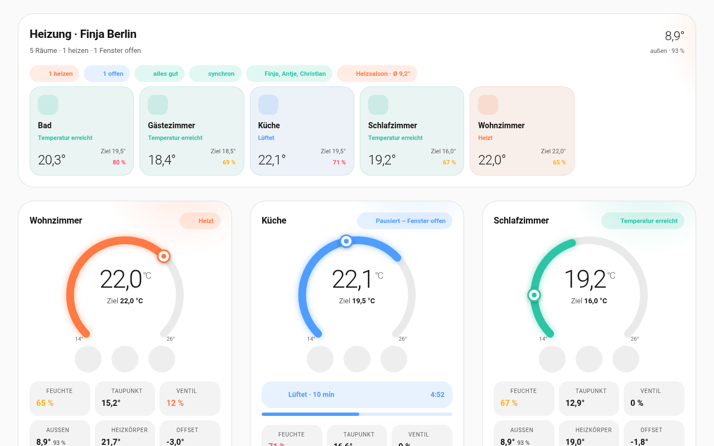
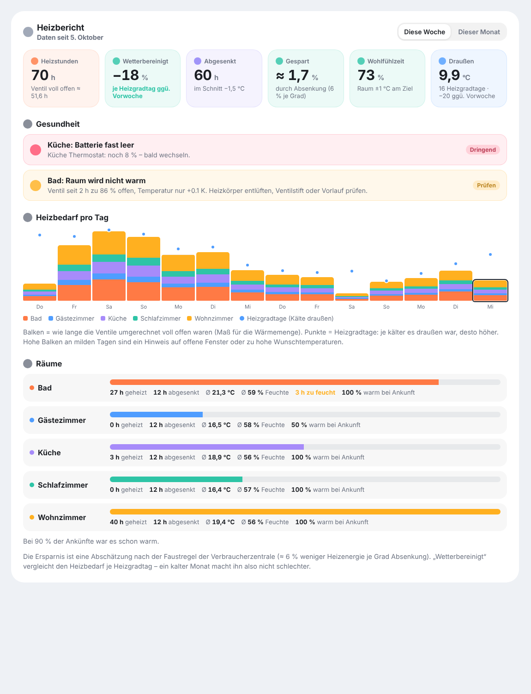
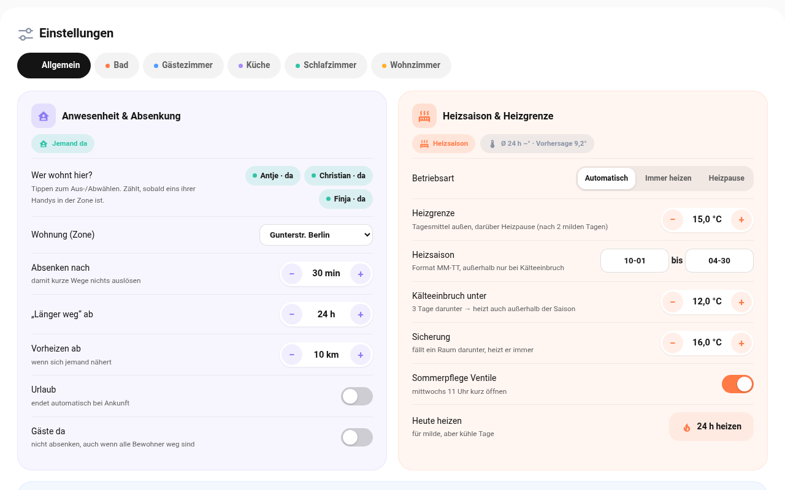

# Bienvenue

**Raumklima** transforme chaque thermostat de radiateur en thermostat d’ambiance qui anticipe. Il régule selon une vraie sonde dans la pièce, se met en pause pendant que vous aérez, abaisse la température quand personne n’est là et ne chauffe pas du tout en été.

Ce manuel explique pas à pas comment installer Raumklima et l’utiliser au quotidien. Aucune connaissance technique n’est nécessaire – il suffit d’un Home Assistant en fonctionnement.

:::tip
**En bref :** configurez une fois, ensuite tout fonctionne tout seul. Vous n’intervenez que lorsque vous voulez autre chose.
:::

> Les captures d’écran montrent l’interface en allemand. Les cartes, les messages push et le journal suivent la langue de votre Home Assistant (anglais, allemand ou français).

## Ce que Raumklima fait pour vous

| | |
|---|---|
| 🌡️ **Mesure correctement** | Régule selon une sonde placée au milieu de la pièce plutôt que selon le thermostat juste à côté du radiateur chaud. |
| 🪟 **Fenêtre ouverte = pause** | Quand une fenêtre est ouverte, le chauffage s’arrête. Ensuite, il reprend avec le réglage précédent. |
| 💨 **Aérer avec un plan** | Vous indique quand l’air est humide ou vicié, combien de temps aérer la pièce et quand c’est suffisant. |
| 🏠 **Personne à la maison = économies** | Abaisse la température quand tout le monde est absent et préchauffe avant le retour de quelqu’un. |
| 🧱 **Protection contre les moisissures** | N’abaisse jamais la température au point que les murs deviennent humides. |
| 🍂 **Chauffe seulement quand il fait froid** | Utilise les prévisions météo pour décider si le chauffage est nécessaire. |
| 📱 **Messages utiles** | Envoie des notifications sur votre téléphone – discrètement la nuit. Si vous le souhaitez, avec un compte à rebours d’aération sur l’écran verrouillé. |
| 💡 **Signal lumineux** | Les lumières de la pièce clignotent en bleu quand il est temps d’aérer et en orange quand la fenêtre doit être fermée. |
| 📈 **Rapport** | Montre combien a été chauffé et combien a été économisé. |

## Ce qu’il vous faut

- **Home Assistant** (version 2026.5 ou plus récente) avec **HACS**
- par pièce, un (ou plusieurs) **thermostat de radiateur** qui apparaît dans Home Assistant – qu’il soit Zigbee, Shelly, Matter ou cloud
- par pièce, une **sonde de température** (idéalement avec humidité)
- en option : des **contacts de fenêtre**, une **sonde CO₂**
- pour la détection de présence : l’**application Home Assistant** sur vos téléphones

# Installation

## Étape 1 : installer

1. Ouvrez **HACS** dans Home Assistant.
2. Touchez **⋮ → Dépôts personnalisés** en haut à droite.
3. Saisissez `https://github.com/Goldi5/Raumklima-2`, catégorie **Intégration**, puis validez.
4. Recherchez **Raumklima** dans HACS et touchez **Télécharger**.
5. **Redémarrez Home Assistant** (*Paramètres → Système → Redémarrer*).

:::tip
Désactivez d’abord la détection de fenêtre intégrée de votre thermostat (si elle existe) et les anciennes automatisations pour les mêmes thermostats. Sinon, ils travaillent l’un contre l’autre.
:::

## Étape 2 : créer la première pièce

Allez dans **Paramètres → Appareils et services → Ajouter une intégration** et choisissez **Raumklima**.

1. **Choisir le thermostat** – celui qui se trouve sur le radiateur.
2. **Sondes et fenêtres** – Raumklima propose des sondes et des contacts de fenêtre de la même pièce. Vérifiez-les, continuez. Si la pièce possède **plusieurs radiateurs**, choisissez les autres thermostats sous **Autres thermostats de cette pièce**. Autant de contacts de fenêtre que vous voulez, c’est parfait.
3. **La pièce** – choisissez le **type de pièce** (salon, chambre, salle de bain…). Cela règle toutes les valeurs de manière sensée. Vous pouvez laisser les réglages techniques sous *Avancé* tels quels.
4. **Pour toute la maison** (première pièce uniquement) – qui habite ici, quelle zone est votre maison, qui reçoit les messages, d’où viennent les données météo.

Répétez l’opération pour chaque pièce supplémentaire – seule l’étape 4 est ignorée.

## Étape 3 : le tableau de bord

Raumklima est livré avec un tableau de bord prêt à l’emploi. Voici comment l’obtenir :

1. Ouvrez **Paramètres → Tableaux de bord**.
2. Touchez **+ Ajouter un tableau de bord** en bas à droite.
3. Choisissez **Raumklima** dans la liste et touchez **Suivant**.
4. Donnez-lui un nom (par ex. « Chauffage ») et une icône, puis **Créer**.

Le nouveau tableau de bord apparaît dans la **barre latérale** à gauche. Il se construit tout seul, avec les onglets *Pièces*, *Historique*, *Rapport*, *Journal* et *Réglages* – et s’enrichit au fur et à mesure que vous ajoutez des pièces.

:::tip
**Raumklima n’apparaît pas dans la liste ?** Rechargez la page (sur ordinateur **Ctrl + F5**, dans l’application : *Paramètres → Application compagnon → Réinitialiser le cache du frontend*). Les cartes sont chargées au démarrage de Home Assistant.
:::

### Les cartes dans votre propre tableau de bord

Vous préférez ajouter les cartes Raumklima à votre tableau de bord existant ? Voici comment faire :

1. Ouvrez votre tableau de bord et touchez le **crayon** (modifier) en haut à droite.
2. Touchez **+ Ajouter une carte**.
3. Saisissez **Raumklima** dans le champ de recherche.
4. Choisissez une carte et touchez **Enregistrer**.

| Carte | Affiche |
|---|---|
| **Raumklima – Vue d’ensemble** | toutes les pièces, la température extérieure, qui est à la maison |
| **Raumklima – Pièce** | une pièce avec sa température, ses commandes et son aération (choisissez la pièce dans l’éditeur) |
| **Raumklima – Historique** | la température, l’humidité ou la chronologie de toutes les pièces |
| **Raumklima – Rapport de chauffage** | semaine et mois, économies, santé |
| **Raumklima – Journal** | ce qui s’est passé, quand et pourquoi |
| **Raumklima – Réglages** | tous les réglages – de préférence sur une page dédiée en pleine largeur |

## Les 10 premières minutes

Après l’installation, prenez un moment pour ces points. Vous trouverez tout dans le tableau de bord sous **Réglages → Allgemein**.

:::check
- **Sélectionnez les habitants** – qui habite ici ?
- **Choisissez la zone** – quelle zone est votre maison ?
- **Ajoutez des destinataires** – qui reçoit les messages ? Vérifiez avec **Tester**.
- **Choisissez une source météo** – par ex. `weather.forecast_home`.
- **Vérifiez les températures souhaitées** – par pièce dans son onglet.
:::

# Au quotidien

## Lire la carte de pièce

- L’**arc** montre la température actuelle, le **point** la température souhaitée.
- **− / +** règle la température souhaitée par demi-degré, **⏻** éteint et rallume la pièce.
- Quand une fenêtre est ouverte, **« Fenêtre ouverte depuis 14:32 · 12 min »** apparaît sous le nom. Dans la vue d’ensemble en haut, vous voyez la durée à côté de l’icône de fenêtre de chaque pièce.
- En haut à droite s’affiche ce que fait la pièce :

| Affiché | Signification |
|---|---|
| **Chauffage** | La pièce est plus froide que souhaité et est en train de chauffer. |
| **Température atteinte** | Tout va bien, il fait assez chaud. |
| **En pause – fenêtre ouverte** | Une fenêtre est ouverte, le chauffage attend. |
| **Aération nocturne – fenêtre ouverte** | Quelqu’un dort avec la fenêtre ouverte. |
| **Abaissement – personne à la maison** | Tout le monde est absent, on économise l’énergie. |
| **Chauffage en pause** | Il fait assez doux dehors. |
| **Éteint** | Vous avez éteint la pièce. |
| **Sonde en panne** | La sonde ne transmet plus – le thermostat continue de réguler tout seul. |
| **Thermostat injoignable** | Problème de radio ou de pile. |

## Aération

Quand l’air devient trop humide (ou, avec une sonde CO₂, vicié), vous recevez **« veuillez aérer la pièce »**. Quand vous ouvrez la fenêtre, la carte affiche un **compte à rebours** avec la durée d’aération recommandée – seulement quelques minutes en hiver.

- **« Air renouvelé »** – vous pouvez fermer.
- **« Durée d’aération atteinte »** – veuillez fermer.
- **« La pièce se refroidit »** – fermez vraiment maintenant.

Les messages ont des boutons : **Terminé**, **Me rappeler dans 15 min** et **Pas aujourd’hui**.

:::tip
Aérer n’aide que lorsque l’air extérieur est plus sec. Raumklima calcule cela et ne vous demande pas d’aérer par temps humide.
:::

### Particules fines (PM2,5)

Si une pièce a un capteur de particules, il apparaît comme une tuile à part. Dès **35 µg/m³** Raumklima
vous demande d’aérer, sous **15 µg/m³** l’air est considéré comme renouvelé. Contrairement à l’humidité,
il n’y a pas de délai : les particules augmentent immédiatement en cuisinant, avec des bougies ou de la fumée.

### Pièce sans chauffage (surveillance)

Certaines pièces n’ont pas de thermostat – couloir, débarras, atelier. Créez-les en **« Surveillance »**
au lieu de « Pièce » : Raumklima mesure la température, l’humidité, le CO₂ et les particules, rappelle
d’aérer et rapporte – mais ne touche **jamais** à une consigne. Dans le tableau de bord, ces pièces
reçoivent leur propre grande carte avec les mêmes mesures, sans plus/moins, ni boost, ni consigne.

## Compte à rebours d’aération sur l’écran verrouillé

Avec l’application Home Assistant, vous voyez aussi le compte à rebours sur l’**écran verrouillé** – sur iPhone sous forme de Live Activity (également dans la Dynamic Island), sur Android dans le volet de notifications. Pas besoin de déverrouiller votre téléphone.

Comment l’activer :

1. Tableau de bord → **Réglages → Allgemein → Qui reçoit quoi**.
2. Touchez **📱 Compte à rebours d’aération sur l’écran verrouillé** pour votre téléphone.
3. La prochaine fois que vous aérez une pièce, confirmez la notification d’écran verrouillé sur l’iPhone.

| Couleur | Signification |
|---|---|
| 🔵 Bleu, minuterie en cours | fenêtre ouverte, continuez d’aérer encore ce temps |
| 🟢 Vert | air renouvelé – vous pouvez fermer |
| 🟠 Orange | durée d’aération atteinte – veuillez fermer |
| 🔴 Rouge | la pièce se refroidit – fermez maintenant |

Quand la fenêtre est fermée, l’affichage disparaît de lui-même.

:::tip
**Prérequis :** iPhone avec iOS 17.2 ou plus récent et Home Assistant 2026.7 ou plus récent. Le téléphone doit pouvoir joindre Home Assistant lorsque vous êtes dehors. Si l’affichage reste bloqué : dans les réglages de l’iPhone, sous *Home Assistant → Live Activities*, désactivez puis réactivez-le.
:::

## Signal lumineux : les lumières le montrent

Tout le monde n’a pas son téléphone à la main. C’est pourquoi les lumières de la pièce peuvent vous prévenir : elles **clignotent trois fois** dans une couleur, puis reprennent leur état précédent.

Comment le configurer :

1. Tableau de bord → **Réglages** → l’onglet de la pièce (par ex. *Salle de bain*).
2. Section **Signal lumineux** → choisissez une lumière dans la liste → **Ajouter une lumière**. Plusieurs lumières fonctionnent aussi.
3. Sous **Clignoter sur**, touchez le moment où elle doit clignoter.
4. Essayez avec **Tester** – les lumières clignotent en bleu.

| Couleur | Quand | dès le départ |
|---|---|---|
| 🔵 Bleu | Veuillez aérer la pièce | activé |
| 🟠 Orange | Veuillez fermer / la pièce se refroidit | activé |
| 🟢 Vert | Air renouvelé | désactivé |
| 🔴 Rouge | Problème avec le chauffage | désactivé |

:::tip
Rien ne clignote pendant les heures calmes la nuit, pendant le sommeil avec la fenêtre ouverte, ou quand personne n’est à la maison. Les lumières sans couleur clignotent simplement en pleine intensité.
:::

## Détecteurs de présence : qui est dans la pièce ?

Avec les détecteurs de présence, Raumklima sait non seulement si quelqu’un est à la maison, mais aussi **dans quelle pièce**. Il en existe deux sortes :

| Quoi | **mmWave** (radar) | **PIR** (détecteur de mouvement) |
|---|---|---|
| détecte | aussi les personnes assises immobiles ou endormies | uniquement le mouvement |
| la pièce est considérée vide | après 3 minutes | seulement après 20 minutes |
| compte pour « quelqu’un est à la maison » | oui | non (les animaux !) – réglable |

**Le mmWave est bien plus fiable.** Le PIR fonctionne aussi, mais Raumklima est plus prudent avec lui.

Comment le configurer :

1. Tableau de bord → **Réglages** → l’onglet de la pièce.
2. Section **Détecteurs de présence** → choisissez un détecteur dans la liste (mmWave ou PIR est indiqué à côté) → **Ajouter un détecteur**.
3. **Abaisser une pièce vide :** *Automatique* rend le salon, la cuisine et les pièces rarement utilisées 1,5 °C plus froids après 30 minutes sans personne – uniquement avec du mmWave. Avec **Oui**, cela s’applique aussi aux autres pièces ou au PIR.

La carte de pièce affiche alors **« Quelqu’un dans la pièce »** ou **« Pièce vide depuis 25 min »**. Quand quelqu’un entre, elle chauffe immédiatement à nouveau jusqu’à la température souhaitée.

:::tip
Un détecteur dans le salon empêche aussi Raumklima de penser à tort que « tout le monde est absent » – par ex. quand un téléphone est éteint ou qu’un visiteur est seul à la maison. Pendant les vacances, les détecteurs ne comptent pas, pour que le chat ne mette pas fin à vos vacances.
:::

## Quand tout le monde est absent

Raumklima le remarque via vos téléphones dès que plus personne n’est à la maison :

| Situation | Ce qui se passe |
|---|---|
| Tout le monde absent depuis 30 minutes | abaissement à environ 18 °C |
| Absence de plus de 24 heures | abaissement à environ 16 °C |
| Quelqu’un est en route vers la maison | préchauffage à temps |
| Quelqu’un rentre | retour à la température souhaitée |

Si vous rentrez plus tôt et qu’il fait trop frais : montez simplement la température – l’abaissement est alors suspendu pendant 3 heures.

## Vacances et visiteurs

- **Vacances :** l’interrupteur *Vacances* dans les réglages – ou un événement de calendrier avec « vacances » dans le titre. Se termine automatiquement à votre retour.
- **Visiteurs :** l’interrupteur *Invités* – dans ce cas, il n’y a pas d’abaissement même lorsque tous les habitants sont sortis.

## Pause de chauffage au printemps et en automne

Quand la moyenne journalière extérieure est douce (par défaut : au-dessus de 15 °C), le chauffage se met en pause. Encore froid ? **Chauffer aujourd’hui** – cela s’applique pendant 24 heures.

## Rapport et journal

L’onglet **Rapport** montre, pour cette semaine ou ce mois, combien de temps le chauffage a fonctionné, combien l’abaissement a permis d’économiser et si le confort était bon. Le dimanche, un court résumé arrive sur votre téléphone.

### Le rapport en PDF

Chaque semaine, chaque mois et à la fin de la saison de chauffage, un **rapport PDF** (4 pages) est créé. Il contient entre autres :

- une **note de A à F** pour votre climat intérieur – avec historique,
- la comparaison avec la période précédente et l’**année précédente**,
- chaque pièce avec une petite **courbe de tendance**, un **classement** et **jours de semaine vs week-end**,
- un **feu tricolore de l’humidité**, le CO₂ et un **résumé d’aération**,
- une **carte de chaleur** indiquant quand il chauffe,
- les **niveaux de pile**, les pannes et des **conseils d’économie** chiffrés.

Si vous saisissez vos **frais de chauffage par an** sous *Réglages → Allgemein → Bâtiment et protection contre les moisissures*, le rapport convertit approximativement les économies en **euros**.

- **Téléchargement :** tout en bas de l’onglet **Rapport** sous *Rapports PDF* – touchez **Télécharger**. Les boutons *Semaine*, *Mois* et *Saison de chauffage* vous donnent immédiatement un rapport jusqu’à aujourd’hui.
- **Sur votre téléphone :** le message push contient un bouton **Ouvrir le PDF**.
- **Par e-mail :** *Réglages → Allgemein → Notifications – général → PDF par e-mail* → touchez **Configurer l’e-mail** juste en dessous, choisissez votre fournisseur (par ex. Gmail), saisissez l’utilisateur, le mot de passe et les destinataires, testez-les avec **Vérifier la connexion**, puis touchez **Enregistrer et envoyer un e-mail de test**. Gmail, iCloud et Outlook nécessitent un mot de passe d’application.

:::tip
Le rapport suit la langue de Home Assistant : allemand, français, anglais pour toute autre langue. Les messages push, le journal et les notifications font de même.
:::

L’onglet **Journal** liste chaque décision avec sa raison – pratique quand vous vous demandez « pourquoi fait-il si froid maintenant ? »

# Réglages

Vous trouverez tous les réglages dans le tableau de bord sous l’onglet **Réglages**. Vous ne savez pas à quoi sert un réglage ? Touchez le **« ? »** à côté pour ouvrir une explication. Les modifications sont enregistrées après une courte pause et prennent effet immédiatement.

:::tip
Vous hésitez ? Gardez les valeurs par défaut. Elles suivent les recommandations des associations de consommateurs allemandes et de l’Agence fédérale de l’environnement allemande.
:::

| Domaine | Ce que vous y réglez |
|---|---|
| **Allgemein → Présence** | habitants, zone, quand abaisser, vacances, invités, calendrier |
| **Allgemein → Saison de chauffage** | quand chauffer, chauffer aujourd’hui |
| **Allgemein → Qui reçoit quoi** | destinataires et quels messages ils reçoivent |
| **Allgemein → Notifications** | heures calmes, rappels, source météo, rapports PDF, e-mail |
| **Allgemein → Heures de sommeil** | Raumklima apprend quand vous dormez |
| **Pièce → Température** | température souhaitée, abaissement, côté ensoleillé |
| **Pièce → Aération et humidité** | à partir de quelle humidité demander une aération |
| **Pièce → Fenêtres** | pause pendant qu’une fenêtre est ouverte, sommeil avec la fenêtre ouverte |
| **Pièce → Détecteurs de présence** | détecteurs, abaisser une pièce vide |
| **Pièce → Signal lumineux** | lumières qui clignotent sur notification |

## Structure des réglages

En haut, vous choisissez le logement, en dessous la pièce – sous forme de puce avec un point coloré
(le point indique si quelque chose demande votre attention dans cette pièce). La barre en dessous passe
d'un groupe à l'autre, le champ de recherche filtre tous les groupes par mot-clé.

Chaque groupe porte sa propre couleur sur le séparateur, l'icône et le titre. Ce n'est pas décoratif :
on voit tout de suite où commence une section.

| Groupe (logement) | Contenu |
|---|---|
| **Logement** | saison de chauffe, toutes les pièces, apparence |
| **Chauffage** | santé du chauffage, seuil de chauffe |
| **Présence** | personnes, zone, vacances, heures de sommeil |
| **Notifications** | destinataires, heures calmes, e-mail, rapports |
| **Apprentissage** | heures de sommeil apprises, profil de présence |

| Groupe (pièce) | Contenu |
|---|---|
| **Pièce** | température, aération, fenêtres, présence, apprentissage |
| **Chauffage** | programme, boost |
| **Notifications** | notifications de cette pièce |

## Ordre, taille et couleur

Sous *Apparence* (logement) vous décidez de l'affichage des pièces dans la vue d'ensemble :

- **Ordre** avec ▲▼ – la première carte est en haut
- **Taille** : grande carte, tuile ou masquée
- **Couleur** : huit teintes, visibles comme liseré sur l'en-tête de la carte

Les changements s'appliquent immédiatement sur toutes les cartes du même logement.

## Apprentissage et pourquoi

Raumklima ne se contente pas de commander, il retient aussi ce qui se passe réellement chez vous.
Vous le trouvez sous *Réglages → Pièce → Apprentissage* et pour le logement sous *Logement → Apprentissage*.

| Valeur | Signification |
|---|---|
| **Vitesse de montée** | rapidité de chauffe d'une pièce (°C par heure), mesurée sur de vraies montées |
| **Préchauffage pour 2 K** | combien de minutes avant une plage horaire il faut démarrer pour être à l'heure |
| **Fiabilité** | *encore incertain* (moins de 3 mesures), *utilisable* (3–5), *fiable* (6 et plus) |
| **S'applique actuellement** | la décision active en ce moment – et en dessous **les dernières décisions avec leur justification** |

Les justifications viennent du journal des décisions, également visible dans l'onglet *Journal*.
Exemple : « Abaissé car personne n'est à la maison depuis 40 minutes. »

### Profil de présence

Toutes les 15 minutes, la centrale note si **quelqu'un** est à la maison – jamais qui. Sur quatre
semaines, cela donne un graphique en barres pour les jours de semaine et le week-end, avec une phrase du
type « généralement quelqu'un à la maison de 17:15 à 08:00 ». C'est la base des propositions d'abaissement
et de préchauffage.

### Heures de sommeil

À partir de l'aération nocturne et des signaux lumineux, Raumklima apprend l'heure de coucher et de lever
habituelles (jours de semaine et week-end séparément, à partir de quatre nuits). Il en déduit les heures
calmes : 30 minutes avant le coucher jusqu'à 30 minutes après le lever – jamais plus court que réglé.

### Les sous-onglets de l'apprentissage

L'espace d'apprentissage est divisé en onglets – selon que vous êtes dans une pièce ou dans *Logement* :

| Onglet | Où | Contenu |
|---|---|---|
| **Aperçu** | pièce | vitesse de montée, préchauffage pour 2 K, fiabilité, décision en cours |
| **Sommeil & présence** | logement | heures de coucher et de lever apprises, profil de présence, suggestion |
| **Décisions** | les deux | historique avec heure, décision et justification – filtrable par période et domaine |
| **Comment ça calcule** | les deux | d'où viennent les valeurs et quelles sont leurs limites |

Dans l'onglet **Décisions**, choisissez la période (aujourd'hui, 7 ou 14 jours) et le domaine
(chauffage, aération, présence, santé). Trois indicateurs en haut, l'historique en dessous. Toucher une
ligne déploie la justification complète avec les valeurs mesurées. Dans *Logement*, un sélecteur de pièce s'ajoute.

## Toutes les pièces en un coup d'œil

La vue d'ensemble affiche chaque logement en tuiles : nom de la pièce, type, la consigne en grand, en
dessous l'abaissement et la température à partir de laquelle aérer est conseillé. De petites icônes
indiquent si la logique de fenêtre est active, si des notifications sont envoyées et si une limite
d'humidité est définie. Touchez pour ouvrir la pièce.

## Saisir des heures et des dates

Les heures ouvrent un sélecteur à deux roues – heures et quarts d'heure – à faire défiler ; les minutes
s'arrêtent par pas de 15 minutes. Dans le champ en dessous, vous pouvez aussi saisir l'heure directement.

Les champs de date (par exemple la saison de chauffe) ouvrent un calendrier. Seuls le jour et le mois
sont enregistrés – l'année n'a pas d'importance.

# Questions fréquentes

<!-- include: ../docs/fr/faq.md -->

# Glossaire

| Terme | Explication |
|---|---|
| **Thermostat (TRV)** | Le régulateur directement sur le radiateur. |
| **Sonde** | Un petit appareil qui mesure la température (et souvent l’humidité) dans la pièce. |
| **Offset** | Une valeur de correction pour que le thermostat « voie » la même température que la sonde. |
| **Zone** | Une zone sur la carte dans Home Assistant, par ex. votre maison. |
| **Abaissement** | Abaisser légèrement la température pour économiser l’énergie. |
| **Limite de chauffage** | Au-dessus de cette température extérieure (moyenne journalière), le bâtiment n’a pas besoin de chauffage. |
| **Point de rosée** | À cette température, l’humidité se transforme en eau – par ex. sur les murs froids. |
| **Degrés-jours de chauffage** | Une mesure de la froideur qu’il a fait dehors. |
| **Heures calmes** | Période pendant laquelle les messages arrivent en silence. |
| **HACS** | Le « magasin d’applications » pour les extensions dans Home Assistant. |

# Obtenir de l’aide

- **Documentation détaillée :** github.com/Goldi5/Raumklima-2 → documentation
- **Signaler un bug ou demander une fonctionnalité :** github.com/Goldi5/Raumklima-2/issues
- **Fichier de diagnostic pour un rapport de bug :** *Paramètres → Appareils et services → Raumklima → pièce → ⋮ → Télécharger les diagnostics*
